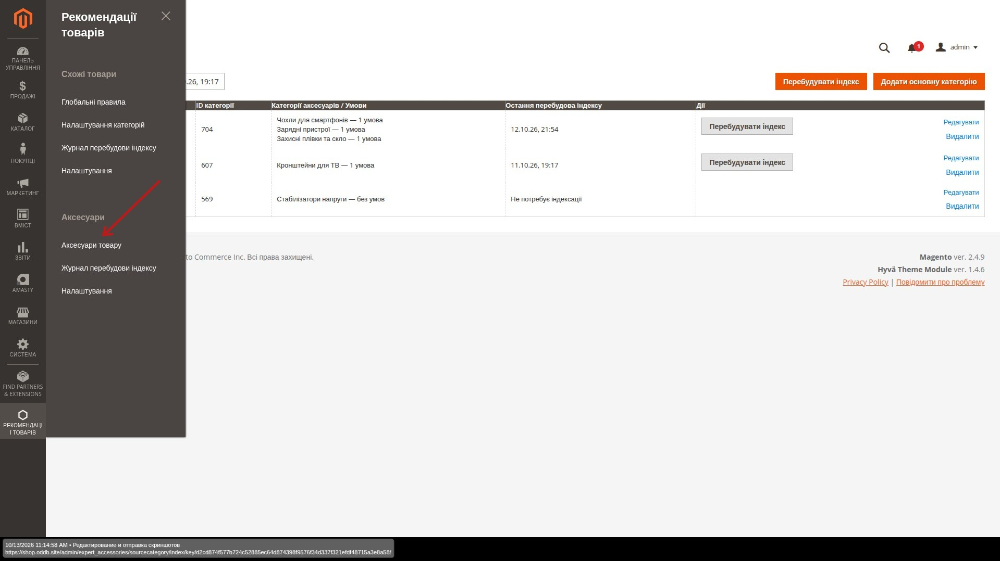
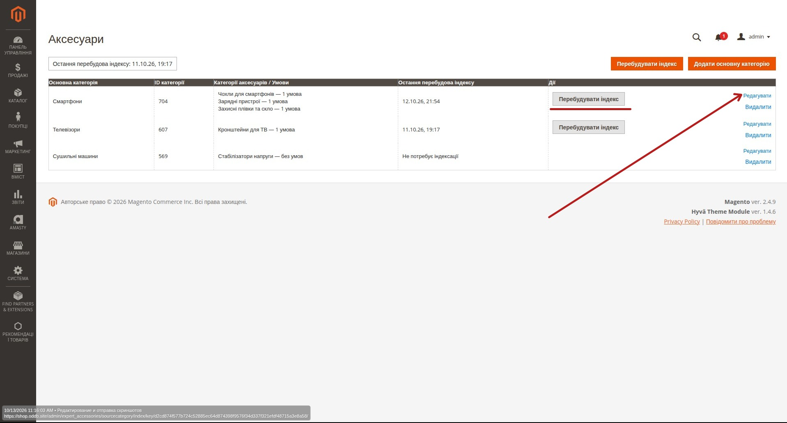
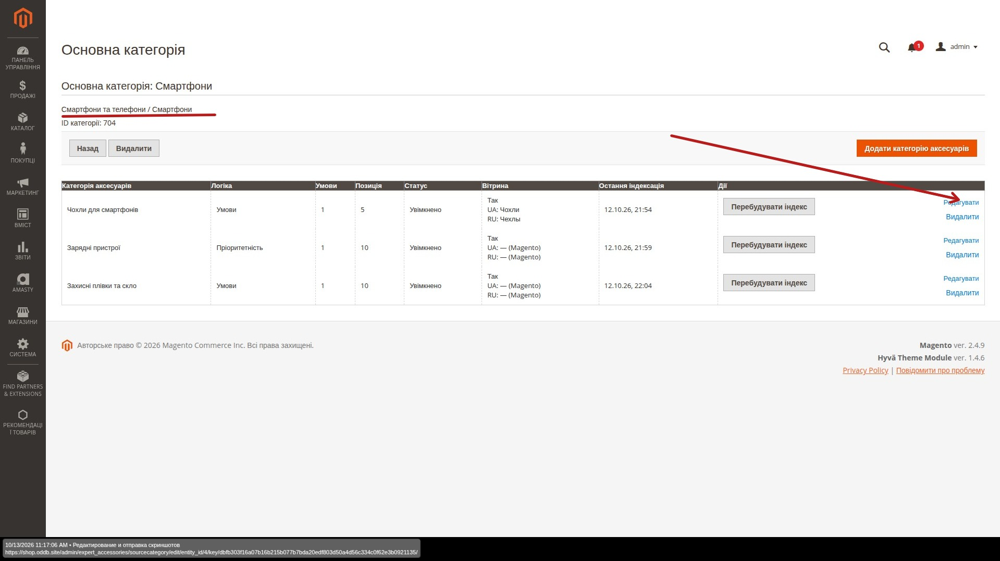
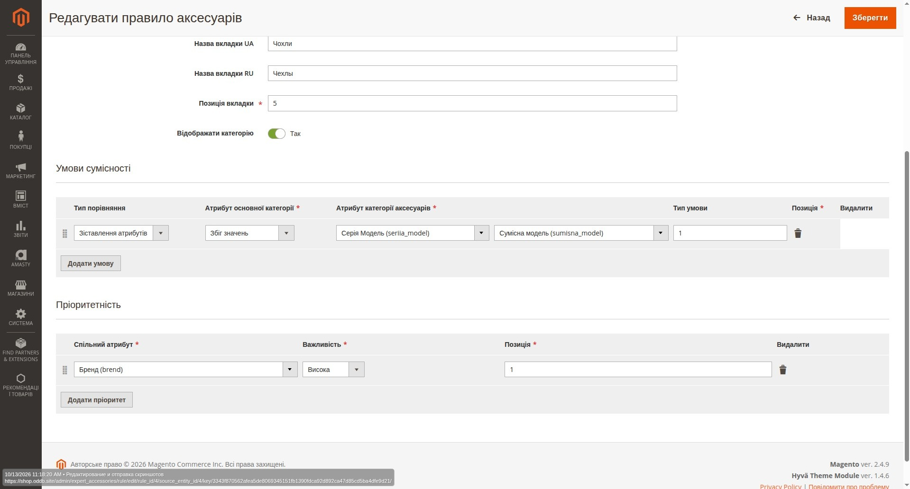
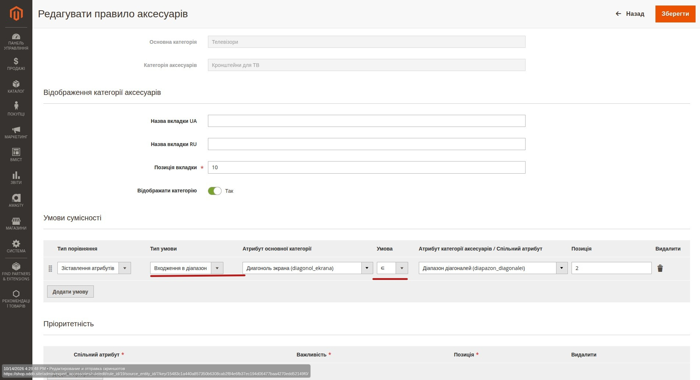
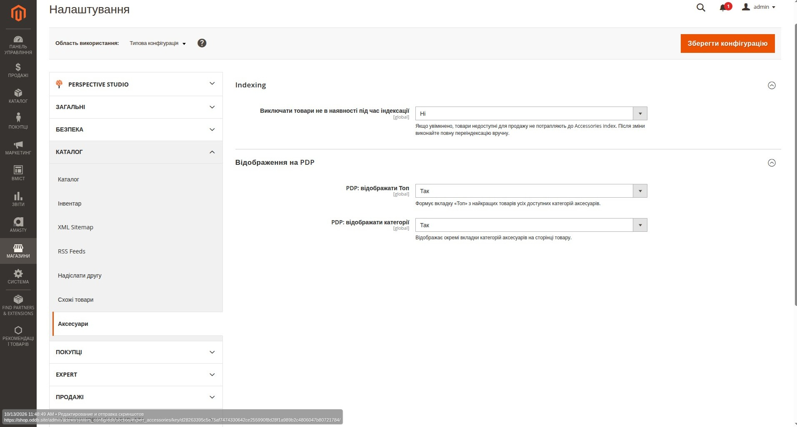
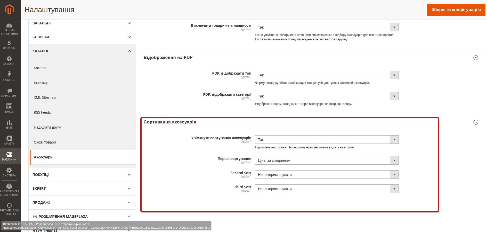
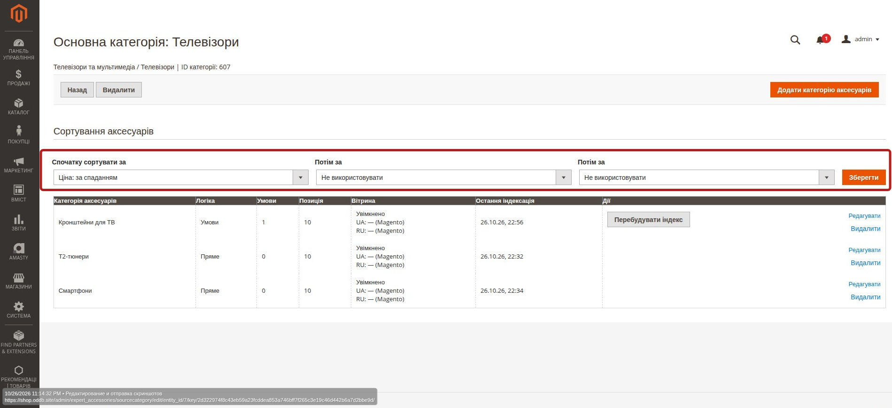
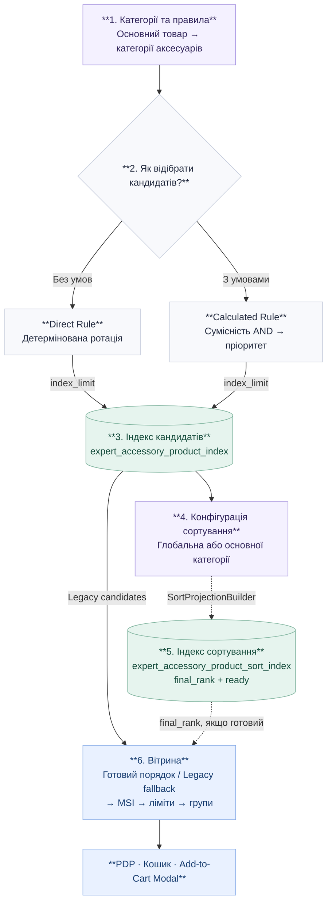

# Аксесуари в Magento: як менеджеру створювати правила сумісності та пріоритетності

## 1. Для чого потрібні правила аксесуарів

Модуль **Аксесуари** визначає, які товари потрібно показувати як аксесуари до основного товару.

Правило завжди працює для пари:

**Основна категорія → Категорія аксесуарів**

Наприклад:

- **Смартфони → Чохли**
- **Смартфони → Захисне скло**
- **Телевізори → Кронштейни**
- **Ноутбуки → Сумки**
- **Принтери → Кабелі**

У межах одного правила можна одночасно:

1. відфільтрувати несумісні товари;
2. залишити тільки сумісні аксесуари;
3. розставити сумісні аксесуари за пріоритетом.

```text
Кандидати з категорії аксесуарів
        ↓
Умови сумісності
        ↓
умова 1
AND
умова 2
AND
умова 3
        ↓
залишилися тільки сумісні товари
        ↓
Пріоритетність
        ↓
нарахування рейтингу
        ↓
сортування
        ↓
найкращі аксесуари
```

### Де знайти модуль в Admin

Керування аксесуарами знаходиться в меню:

`Рекомендації товарів → Аксесуари → Аксесуари товару`



На цій сторінці менеджер переходить до списку основних категорій, налаштовує категорії аксесуарів, редагує правила та запускає перебудову індексу.

## 2. Основні поняття

### Основна категорія
Категорія товару, для якого ми шукаємо аксесуари.

Наприклад: **Смартфони**.

Основний товар: **Apple iPhone 17 Pro**.

### Категорія аксесуарів
Категорія, з якої система повинна підбирати товари.

Наприклад: **Чохли для смартфонів** або **Зарядні пристрої**.

### Умови сумісності
Це **обов'язкові умови**. Якщо товар не пройшов хоча б одну умову — він не потрапляє до результату.

Усі рядки в секції **«Умови сумісності»** працюють через **AND**.

```text
Серія моделі = Сумісна модель
AND
Колір = Колір
```

Товар має пройти **обидві** умови.

### Пріоритетність
Пріоритетність не визначає, чи сумісний товар. Вона визначає, який із уже сумісних товарів потрібно показати вище.

Якщо аксесуар не збігся за критерієм пріоритетності, він **не видаляється** з результату. Він просто отримує менше балів і опускається нижче.

---

## 3. Як створити правило

На головній сторінці **«Аксесуари»** відображаються основні категорії, підключені до них категорії аксесуарів, стан індексації та доступні дії.



Щоб налаштувати правила для конкретної основної категорії, натисніть **«Редагувати»** у відповідному рядку.

### Крок 1. Обрати основну категорію
Наприклад: **Смартфони**.

### Крок 2. Обрати категорію аксесуарів
Наприклад: **Чохли для смартфонів**.

Тепер правило описує зв'язок:

```text
Смартфони
→
Чохли для смартфонів
```

На сторінці основної категорії видно всі підключені категорії аксесуарів, їхню логіку, кількість умов, позицію, стан вітрини, останню індексацію та дії.



Щоб змінити конкретне правило, натисніть **«Редагувати»** навпроти потрібної категорії аксесуарів. Щоб додати нову категорію — **«Додати категорію аксесуарів»**.

---

## 4. Відображення категорії аксесуарів

У формі є окремий блок **«Відображення категорії аксесуарів»**.

Він не впливає на сумісність товарів. Він відповідає тільки за те, **як категорія буде показана покупцю**.

Доступні поля:
- **Назва вкладки UA**
- **Назва вкладки RU**
- **Позиція вкладки**
- **Відображати категорію**

Нижче в цій самій формі знаходяться **«Умови сумісності»** та **«Пріоритетність»**, тому вся логіка конкретної пари категорій налаштовується в одному місці.



### Приклад
Magento-категорія має назву: **Чохли для смартфонів**.

Але на сторінці товару ми хочемо коротшу назву:

```text
Назва вкладки UA: Чохли
Назва вкладки RU: Чехлы
```

На українській вітрині покупець побачить **Чохли**, на російській — **Чехлы**.

Якщо поле залишити порожнім, система використовує стандартну назву Magento-категорії для відповідної мови.

### Позиція вкладки
Поле визначає порядок категорій аксесуарів на сторінці товару.

```text
Чохли              10
Захисне скло       20
Зарядні пристрої   30
```

### Відображати категорію
**Так** — категорія бере участь у storefront.

**Ні** — категорія не показується покупцю.

Вимкнення категорії:
- не видаляє правило;
- не видаляє індекс;
- не потребує перебудови індексу.

---

## 5. Умови сумісності

Секція **«Умови сумісності»** відповідає на питання:

> Чи можна взагалі показувати цей аксесуар для даного товару?

Кожна додана умова є обов'язковою. Між рядками система показує **AND**.

---

## 6. Зіставлення різних атрибутів

Цей варіант використовується, коли в основного товару та аксесуара інформація описується **різними атрибутами**.

Класичний приклад:

- смартфон має атрибут **Серія Модель**;
- чохол має атрибут **Сумісна модель**.

Це логічно різні характеристики:
- смартфон описує **свою модель**;
- чохол описує **з якими моделями він сумісний**.

Тому правило будуємо так:

```text
Серія Модель
Збіг значень
Сумісна модель
```

---

## 7. Детальний приклад: смартфон → чохол

Основний товар: **Apple iPhone 17 Pro**.

У нього:

```text
Серія Модель = Apple iPhone 17 Pro
```

Є три чохли.

### Чохол A
```text
Сумісна модель:
Apple iPhone 17 Pro
```
Результат: **сумісний**.

### Чохол B
```text
Сумісна модель:
Apple iPhone 16 Pro
```
Результат: **не сумісний**.

### Чохол C
```text
Сумісна модель:
Apple iPhone 17 Pro,
Apple iPhone 17 Pro Max
```
Результат: **сумісний**.

До результату потраплять:

```text
Чохол A
Чохол C
```

Чохол B буде виключений.

---

## 8. Чому потрібно правильно вибирати атрибут зліва і справа

Ліва сторона — це характеристика **основного товару**.

Права сторона — характеристика **аксесуара**.

```text
Основний товар:
Серія Модель

Аксесуар:
Сумісна модель
```

Не потрібно вибирати два атрибути тільки тому, що їх назви схожі. Потрібно подумати про їх бізнес-сенс:

> Що описує сам товар і що описує можливість аксесуара працювати з цим товаром?

---

## 9. «Спільний атрибут»

Якщо в основного товару та аксесуара використовується **той самий атрибут**, не потрібно вибирати його двічі.

Для цього є **«Спільний атрибут»**.

Наприклад: **Колір**.

Система трактує це як:

```text
Колір основного товару
=
Колір аксесуара
```

### Приклад

Телевізор:
```text
Колір = Чорний
```

Кронштейн A:
```text
Колір = Чорний
```
Результат: **TRUE**.

Кронштейн B:
```text
Колір = Білий
```
Результат: **FALSE**.

---

## 10. Важливо: «Спільний атрибут» — це не фіксоване значення

Умова:

```text
Спільний атрибут: Колір
```

означає:

```text
Колір основного товару = Колір аксесуара
```

Вона **не означає**:

```text
Колір аксесуара = Чорний
```

Фіксовані значення на кшталт `Бренд = Samsung` або `Колір = Чорний` є окремим типом функціональності та в поточній моделі не використовуються.

---

## 11. Числові умови

Для числових характеристик використовуються:

- `=` — дорівнює
- `≤` — менше або дорівнює
- `≥` — більше або дорівнює

---

## 12. Приклад: телевізор → кронштейн

Основний товар: **Телевізор 55"**.

Кронштейн має характеристику:

```text
Максимальна діагональ = 65"
```

Правило:

```text
Діагональ екрана
≤
Максимальна діагональ
```

Перевірка:

```text
55 ≤ 65
```

Результат: **TRUE**.

### Що буде для телевізора 24"

Якщо правило лише:

```text
Діагональ ТВ ≤ Максимальна діагональ кронштейна
```

то:

```text
24 ≤ 65
```

також TRUE.

Тому кронштейн з максимальною діагоналлю 65" теж буде вважатися сумісним. Це не помилка — саме так сформульоване правило.

---

## 13. Мінімальна та максимальна діагональ

Якщо у кронштейна є:
- мінімальна діагональ;
- максимальна діагональ;

можна створити **дві умови**, якщо мінімальна та максимальна діагоналі зберігаються в окремих атрибутах:

```text
Мінімальна діагональ кронштейна
≤
Діагональ телевізора

AND

Діагональ телевізора
≤
Максимальна діагональ кронштейна
```

Для кронштейна `32–65"` і телевізора `55"`:

```text
32 ≤ 55   TRUE
AND
55 ≤ 65   TRUE
```

Кронштейн сумісний.

Для телевізора 24":

```text
32 ≤ 24   FALSE
```

Товар буде виключений ще до перевірки пріоритетності.

---

## 14. Входження в діапазон

Якщо аксесуар має **один атрибут із діапазоном значень** (наприклад, `32"–65"`), замість двох окремих числових умов можна використати тип **«Входження в діапазон»**. Система перевірить, чи потрапляє значення основного товару між нижньою та верхньою межами включно.

### Як налаштувати правило

У секції **«Умови сумісності»** додайте рядок і виберіть:

| Поле | Значення для прикладу |
|---|---|
| **Тип порівняння** | Зіставлення атрибутів |
| **Тип умови** | Входження в діапазон |
| **Атрибут основної категорії** | Діагональ екрана |
| **Умова** | `∈` — входить у діапазон |
| **Атрибут категорії аксесуарів** | Діапазон діагоналей |



### Приклад перевірки

Основний товар: **телевізор 55"**. Кронштейн має атрибут **Діапазон діагоналей = `32"–65"`**.

```text
32 ≤ 55 ≤ 65  → TRUE  → кронштейн сумісний
32 ≤ 75 ≤ 65  → FALSE → кронштейн не сумісний
```

**Підтримувані значення:** в основного товару — одне число з атрибута `int`, `decimal`, `varchar`, `text` або `select`; у аксесуара — діапазон з `varchar`, `text`, `select` або `multiselect`. Для `select`/`multiselect` використовуються назви значень, а не їхні технічні ID. Якщо у аксесуара кілька діапазонів (`multiselect`), достатньо потрапити **хоча б в один** із них (OR). `Multiselect` для основного товару в цьому типі умови не використовується.

Діапазони можуть мати вигляд `32-65`, `32 – 65`, `32"–65"`, `32.5–65.5`. **Одиниці вимірювання не перевіряються та не конвертуються**: менеджер самостійно обирає атрибути з порівнюваними значеннями. Порожні або некоректні значення не проходять умову сумісності.

Це **обов'язкова умова**: як і інші рядки секції, вона поєднується з рештою через **AND**. Після збереження змін потрібно вручну натиснути **«Перебудувати індекс»**.

---

## 15. Як працюють декілька умов сумісності

Приклад:

```text
Діагональ ТВ ≤ Максимальна діагональ
AND
Мінімальна діагональ ≤ Діагональ ТВ
AND
VESA = VESA
AND
Колір = Колір
```

Аксесуар повинен пройти **кожну** умову.

Якщо хоча б одна повернула FALSE:

```text
TRUE
AND
TRUE
AND
FALSE
AND
TRUE
```

загальний результат: **FALSE**.

Товар виключається.

---

## 16. Що означає «Позиція» в умовах

Позиція рядка визначає порядок відображення та обробки умов.

```text
1. Діагональ
2. VESA
3. Колір
```

Але позиція **не змінює логіку AND**. Усі обов'язкові умови все одно повинні виконатися.

---

## 17. Що таке «Пріоритетність»

Після того як система виключила всі несумісні товари, може залишитися багато хороших кандидатів.

Тоді використовується **«Пріоритетність»**.

Її мета:

> показати кращі сумісні товари вище.

Пріоритетність **не є додатковим фільтром**.

---

## 18. Приклад пріоритетності за брендом

Основний товар:

```text
Бренд = Samsung
```

Після умов сумісності залишилися три аксесуари:

```text
A — Samsung
B — KSL
C — Samsung
```

Додаємо:

```text
Пріоритетність

Спільний атрибут: Бренд
Важливість: Висока
```

Тоді:

```text
A → збіг бренду → отримує вагу
B → бренди не збіглися → +0
C → збіг бренду → отримує вагу
```

B не видаляється. Він просто буде нижче за A та C.

---

## 19. Декілька критеріїв пріоритетності

Можна додати:

```text
Бренд   — Висока
Колір   — Нормальна
Серія   — Низька
```

Це **не AND**.

Кожний критерій незалежно додає свій внесок до рейтингу:

```text
score(Бренд)
+
score(Колір)
+
score(Серія)
```

---

## 20. Приклад: фільтр + пріоритетність

Основний товар:

```text
Телевізор
55"
Samsung
Чорний
```

Умови сумісності:

```text
Мінімальна діагональ ≤ 55
AND
55 ≤ Максимальна діагональ
```

Пріоритетність:

```text
Бренд — Висока
Колір — Нормальна
```

### Кронштейн A
```text
32–65"
Samsung
Чорний
```
- сумісність: PASS
- бренд: збіг
- колір: збіг

Рейтинг: високий.

### Кронштейн B
```text
32–65"
KSL
Чорний
```
- сумісність: PASS
- бренд: не збігся
- колір: збіг

Рейтинг нижчий.

### Кронштейн C
```text
32–43"
Samsung
Чорний
```
- сумісність: FAIL

Кронштейн C повністю виключається. Навіть сильний збіг за брендом не може повернути товар, який не пройшов умови сумісності.

Фінальний порядок:

```text
1. Кронштейн A
2. Кронштейн B
```

---

## 21. Важливість пріоритету

Для критеріїв використовуються рівні:
- **Висока**
- **Нормальна**
- **Низька**

Менеджеру не потрібно вручну рахувати бали. Потрібно визначити бізнес-пріоритет.

```text
Бренд — Висока
Колір — Нормальна
Серія — Низька
```

означає:

> збіг бренду важливіший за збіг кольору, а збіг кольору важливіший за збіг серії.

---

## 22. Що означає декілька рядків пріоритетності

Наприклад:

```text
1. Бренд — Висока
2. Колір — Нормальна
```

це не:

```text
Бренд AND Колір
```

а логіка:

```text
score(Бренд)
+
score(Колір)
```

Якщо бренд не збігся, але колір збігся, товар все одно залишається.

---

## 23. Приклад для чохлів

Основна категорія: **Смартфони**.

Категорія аксесуарів: **Чохли**.

### Умови сумісності

```text
Серія Модель
Збіг значень
Сумісна модель
```

Це головна умова. Чохол повинен бути сумісним саме з моделлю смартфона.

### Пріоритетність

Наприклад:

```text
Бренд       Висока
Price View  Нормальна
Колір       Низька
```

Система:
1. спочатку залишає тільки чохли для потрібної моделі;
2. потім піднімає вище найбільш бажані товари.

---

## 24. Правило тільки з умовами

Це нормальний варіант.

Наприклад:

```text
Серія Модель = Сумісна модель
```

без пріоритетності.

Система:
1. відфільтрує сумісні товари;
2. використає стандартний детермінований порядок для результату.

Пріоритетність не є обов'язковою.

---

## 25. Правило тільки з пріоритетністю

Технічно правило може містити критерії пріоритетності без обов'язкових фільтрів.

У такому випадку всі кандидати цільової категорії можуть залишитися в наборі, а система лише відсортує їх за рейтингом.

Такий сценарій слід використовувати обережно.

Якщо у категорії є реальна технічна сумісність, краще спочатку описати її через **Умови сумісності**.

---

## 26. Пряме правило

Якщо у правила немає жодної умови та жодної пріоритетності, воно працює як **Пряме**.

Тобто система бере товари з цільової категорії без calculated-порівнянь.

Приклад:

```text
Основна категорія:
Кавомашини

Категорія аксесуарів:
Засоби для очищення
```

Якщо всі товари цієї категорії загалом підходять, додаткові умови можуть бути не потрібні.

---

## 27. Що означає колонка «Логіка»

В Admin-таблиці правило може відображатися як:

- **Пряме** — немає умов.
- **Умови** — є тільки обов'язкові умови сумісності.
- **Пріоритетність** — є критерії рейтингу без filter-умов.
- **Умови + пріоритет** — є і жорсткий filter, і наступне сортування.

Для більшості технічно складних аксесуарів найкорисніший сценарій:

**Умови + пріоритет**

---

## 28. Коли потрібно перебудовувати індекс

Зміна логіки правила є semantic change.

Наприклад:
- додали умову;
- видалили умову;
- змінили атрибут;
- змінили `Збіг значень` на числове порівняння;
- змінили `≤` на `≥`;
- додали або змінили «Входження в діапазон»;
- додали або змінили пріоритетність;
- змінили важливість.

Після таких змін Admin показує:

**Потрібна переіндексація**

Менеджер повинен вручну натиснути:

**Перебудувати індекс**

Автоматично Rule після редагування не перебудовується.

---

## 29. Коли перебудова індексу НЕ потрібна

Не потрібно перебудовувати індекс, якщо змінили тільки:
- Назва вкладки UA;
- Назва вкладки RU;
- Позиція вкладки;
- Відображати категорію.

Ці параметри не змінюють сам підбір товарів.

---

## 30. Що показує «Вітрина» в таблиці

Колонка **«Вітрина»** дозволяє швидко побачити стан Category Assignment.

```text
Так
UA: Чохли
RU: Чехлы
```

означає:
- категорія відображається;
- є custom UA label;
- є custom RU label.

Якщо бачимо:

```text
Так
UA: — (Magento)
RU: — (Magento)
```

це означає:
- категорія відображається;
- custom labels не задані;
- використовуються стандартні назви Magento-категорії.

---

## 31. Як працює «Топ»

На PDP категорії аксесуарів можуть виглядати так:

```text
Топ
Чохли
Захисне скло
Зарядні пристрої
```

`Топ` — це не окрема категорія і не окреме правило.

Він автоматично збирається з найкращих товарів реальних категорій аксесуарів.

Товари беруться почергово:

```text
1-й товар категорії A
1-й товар категорії B
1-й товар категорії C

2-й товар категорії A
2-й товар категорії B
2-й товар категорії C
...
```

Це не дозволяє одній великій категорії зайняти весь Top.

### Якщо категорія лише одна

Якщо на PDP залишилася лише одна реальна категорія аксесуарів, окрема вкладка `Топ` не показується.

Замість:

```text
Топ | Кронштейни
```

буде:

```text
Кронштейни
```

---

## 32. Глобальні налаштування модуля

Загальні параметри Accessories знаходяться в:

`Stores → Configuration → Catalog → Аксесуари`



На сторінці є два основні блоки.

### Indexing

Параметр **«Виключати товари не в наявності»** діє для всіх типів правил.

- **Ні** — товари не виключаються з persistent Accessories index тільки через наявність; на storefront доступні показуються перед недоступними.
- **Так** — товари, які MSI вважає недоступними для продажу, не потрапляють до індексу під час rebuild і повторно виключаються на storefront за поточним станом MSI.

Після зміни цього параметра потрібно **вручну перебудувати індекс Accessories**. Саме збереження налаштування не запускає rebuild автоматично.

### Сортування аксесуарів

Налаштування знаходяться в тому самому розділі:

`Stores → Configuration → Catalog → Аксесуари → Сортування аксесуарів`



Увімкніть **«Увімкнути сортування аксесуарів»**, щоб застосовувати готовий порядок до вже підібраних аксесуарів. Нижче задайте від одного до трьох критеріїв:

1. **First Sort** — головний критерій;
2. **Second Sort** — застосовується, коли значення першого критерію однакові;
3. **Third Sort** — застосовується, коли однакові перші два значення.

Доступні критерії: **Найпопулярніші**, **Найбільш переглядувані**, **Новинки**, **Найбільша знижка**, **Ціна: за зростанням**, **Ціна: за спаданням**, **Рейтинг** і **Позиція в категорії**.

Критерії не можна повторювати. Не можна вибрати другий критерій без першого або третій без другого. Значення **«Не використовувати»** у всіх трьох полях означає, що глобальної послідовності немає.

Глобальна послідовність використовується для основних категорій, у яких не задано власну послідовність. Якщо сортування вимкнено, вітрина завжди використовує стандартний порядок кандидатів.

Після зміни, очищення або видалення глобальної послідовності модуль позначає sort projection для товарів усіх зареєстрованих основних категорій як застарілий. Поки новий projection не готовий, покупець безпечно бачить стандартний порядок. Magento cron через чергу Accessories перебудовує лише sort projection; candidate index і правила сумісності не перебудовуються. Якщо cron не працює або порядок потрібно оновити негайно, виконайте projection-only команду `bin/magento expert:accessories:sort:reindex --all`.

### Власне сортування основної категорії

Щоб налаштувати порядок лише для однієї основної категорії, відкрийте:

`Рекомендації товарів → Аксесуари → Аксесуари товару → Редагувати`

У блоці **«Сортування аксесуарів»** виберіть до трьох послідовних критеріїв і натисніть **«Зберегти»**.



Правила заповнення такі самі: перший критерій є основним, наступні розв'язують рівність попередніх; повтори та пропуски в послідовності не допускаються. Власна конфігурація основної категорії повністю замінює глобальну — критерії не об'єднуються.

Щоб повернути категорію до глобальної послідовності, встановіть **«Не використовувати»** у першому полі. Збереження видаляє локальну конфігурацію. Якщо глобальної послідовності також немає, лишається стандартний порядок кандидатів.

Після збереження локальної конфігурації модуль позначає projection товарів цієї основної категорії як застарілий і прибирає його стан `ready`. Cron створює окрему projection-only задачу; до її успішного завершення вітрина використовує стандартний порядок. Candidate index вручну перебудовувати не потрібно. За потреби негайного оновлення використовуйте `bin/magento expert:accessories:sort:reindex --category-id=<ID_категорії>`.

### Пріоритет налаштувань сортування

```text
Сортування основної категорії
        ↓ якщо відсутнє
Глобальне сортування
        ↓ якщо відсутнє або сортування вимкнене
Стандартний порядок кандидатів (Legacy Order)
```

Сортування лише переставляє кандидатів, які вже потрапили до індексу. Воно не створює нових кандидатів, не змінює умови сумісності, пріоритетність правил або політику MSI availability.

### Відображення на PDP

Параметр **«PDP: відображати Топ»** керує віртуальною вкладкою **«Топ»**.

Параметр **«PDP: відображати категорії»** керує окремими вкладками реальних категорій аксесуарів.

Поточна поведінка:

```text
Top = Так
Категорії = Так
2+ реальні категорії
→ Топ + вкладки категорій
```

```text
Top = Так
Категорії = Так
1 реальна категорія
→ тільки вкладка цієї категорії
```

```text
Top = Так
Категорії = Ні
2+ реальні категорії
→ тільки Топ
```

```text
Top = Ні
Категорії = Так
→ тільки вкладки категорій
```

```text
Top = Ні
Категорії = Ні
→ блок аксесуарів на PDP не показується
```

Якщо після storefront-фільтрації залишається тільки одна реальна категорія, окрема вкладка **«Топ»** не створюється, оскільки вона дублювала б єдину категорію.

Ці параметри є presentation-настройками: вони не змінюють Rule conditions і не потребують перебудови Accessories index.

---

## 33. Рекомендований порядок створення нового правила

### Крок 1
Визначити:

```text
Основна категорія
→
Категорія аксесуарів
```

### Крок 2
Запитати:

> Яка характеристика визначає реальну сумісність?

Приклади:
- модель;
- серія;
- розмір;
- діагональ;
- VESA;
- тип роз'єму;
- потужність;
- сумісна платформа.

### Крок 3
Визначити, це різні атрибути чи один спільний атрибут.

Різні:

```text
Серія моделі
→
Сумісна модель
```

Спільний:

```text
Колір
=
Колір
```

### Крок 4
Якщо є декілька обов'язкових параметрів — додати їх окремими рядками.

Система з'єднає їх через **AND**.

### Крок 5
Перевірити:

> Чи потрібне додаткове сортування вже сумісних товарів?

Якщо так — додати **Пріоритетність**.

### Крок 6
Визначити важливість:

```text
Висока
Нормальна
Низька
```

### Крок 7
Зберегти правило.

Якщо змінювалися умови або пріоритетність — виконати ручну перебудову індексу.

---

## 34. Практичний чекліст менеджера

Перед збереженням правила перевірте:

- [ ] Правильно вибрана основна категорія.
- [ ] Правильно вибрана категорія аксесуарів.
- [ ] Зрозуміло, яка характеристика основного товару порівнюється з якою характеристикою аксесуара.
- [ ] Для однакових атрибутів використано `Спільний атрибут`.
- [ ] Усі mandatory-умови справді повинні виконуватися одночасно.
- [ ] Напрямок `≤` / `≥` правильний.
- [ ] Для «Входження в діапазон» обрано атрибут з одним числом зліва й атрибут із діапазоном справа.
- [ ] Пріоритетність використовується тільки для сортування, а не для жорсткої сумісності.
- [ ] Правильно вибрана важливість пріоритетів.
- [ ] Перевірені UA/RU назви вкладки.
- [ ] Вказана правильна позиція вкладки.
- [ ] Перевірено `Відображати категорію`.
- [ ] Після semantic-зміни правила виконана ручна перебудова індексу.

---

## 35. Типові помилки

### Помилка 1. Використовувати пріоритетність замість сумісності
Якщо аксесуар фізично не може працювати з іншою моделлю, це має бути **Умова сумісності**, а не просто високий пріоритет.

### Помилка 2. Очікувати, що priority miss видалить товар
Не видалить.

```text
MISS → +0 до рейтингу
```

а не:

```text
MISS → виключити товар
```

### Помилка 3. Неправильний напрямок numeric comparator

```text
Діагональ ТВ ≤ Максимальна діагональ кронштейна
```

означає саме:

```text
55 ≤ 65
```

### Помилка 4. Вважати позицію вагою
`Позиція` — порядок рядка.

`Важливість` — сила priority-критерію.

### Помилка 5. Створювати два однакові атрибути вручну
Якщо атрибут один і той самий з обох боків, використовуйте **Спільний атрибут**.

### Помилка 6. Перебудовувати індекс після зміни тільки назви вкладки
Не потрібно.

---

## 36. Коротка пам'ятка

### Умови сумісності
**Визначають, чи потрапить товар до результату.**

```text
FAIL → товар виключено
```

Усі умови:

```text
AND
```

### Пріоритетність
**Визначає порядок уже сумісних товарів.**

```text
MISS → товар залишається, але має нижчий рейтинг
```

Кілька priority rows:

```text
score 1 + score 2 + score 3
```

### Спільний атрибут

```text
source.attribute = target.attribute
```

### Входження в діапазон

```text
32 ≤ 55 ≤ 65 → сумісний
```

Для одного атрибута-діапазону використовуйте тип «Входження в діапазон».

### Assignment / Відображення категорії

Визначає:

```text
UA label
RU label
позицію вкладки
видимість категорії
```

і не потребує reindex.

---

## 37. Головний принцип

При створенні правила менеджер повинен спочатку відповісти на два питання.

### Питання 1
**Що робить аксесуар реально сумісним з основним товаром?**

Це потрібно описати в **Умовах сумісності**.

### Питання 2
**Серед усіх сумісних товарів які характеристики роблять один товар бажанішим за інший?**

Це потрібно описати в **Пріоритетності**.

Якщо ці два питання розділені правильно, правило буде передбачуваним, зрозумілим і зручним для подальшої підтримки.

---

## 38. Технічна архітектура індексу

### Коротка карта процесу



> Якщо Mermaid не підтримується у переглядачі Markdown, короткий порядок: **правила → Direct Rule / Calculated Rule → Deterministic Rotation / сумісність і пріоритет → індекс кандидатів → глобальна або категоріальна конфігурація → sort projection → `final_rank` → PDP, кошик і Add-to-Cart Modal**.

**Детальний опис усіх механізмів — нижче.**


Цей розділ описує фактичний механізм storefront після переходу на єдину індексацію. Він є джерелом істини для розробки; попередній runtime-пошук товарів Direct Rule у `catalog_category_product` більше не використовується.

### Єдина таблиця зв'язків

Усі увімкнені валідні правила — як Direct Rule без умов, так і calculated Rule з умовами — матеріалізуються в `expert_accessory_product_index`.

| Поле | Призначення |
| --- | --- |
| `product_id` | ID вихідного товару, на PDP або в кошику якого показуються рекомендації. |
| `rule_id` | Правило, що створило зв'язок. |
| `accessory_product_id` | ID рекомендованого товару. |
| `preference_score` | Результат priority-умов calculated Rule; для Direct Rule дорівнює `0`. |
| `rank` | Порядковий номер кандидата в межах пари source product + rule. |

Первинний ключ не допускає повтору одного accessory у межах однієї пари source product + rule. Унікальність `(product_id, rule_id, rank)` робить порядок однозначним. Запис індексу не є підтвердженням поточної доступності товару: вона повторно перевіряється на storefront.

### Побудова індексу

`RuleRebuilder` спочатку читає source і target категорії, а потім відсіює неeligible товари (website, статус і visibility). Якщо увімкнено **«Виключати товари не в наявності»**, target-кандидати також відсіюються через MSI для stock поточного website. Лише після цього застосовується `index_limit`.

Direct Rule не має conditions. Для кожного eligible source product rebuild бере впорядкований пул eligible target product, виключає сам source product і зберігає не більш ніж `index_limit` кандидатів. `preference_score` для цих рядків нульовий.

Calculated Rule має два незалежні типи conditions:

- `filter` — обов'язкова сумісність; усі такі умови утворюють AND і відсіюють target-кандидатів;
- `priority` — оцінює вже сумісні товари. Невідповідність priority не виключає товар, а додає нуль до його `preference_score`.

Якщо у calculated Rule є priority-умови, кандидати ранжуються за обчисленим preference score перед записом `rank`; без priority-умов використовується детермінований порядок ID. Це **індексний** порядок, а не runtime-сортування за наявністю.

### Детермінована ротація товарів (Deterministic Rotation)

Для Direct Rule базовий пул упорядковано позицією товару в target category, а потім ID товару. `RuleRebuilder` обчислює стабільний offset з `crc32(source_product_id . ':' . rule_id)` і читає кругове вікно з цього пулу до `index_limit`.

Отже, два різних source product можуть отримати різні, але відтворювані набори. Ротація не виконується на PDP, не використовує `ORDER BY RAND()` і не змінює порядок при повторному перегляді за незмінних даних індексу.

Це практичне застосування патерна [Deterministic Rotation — детермінована
ротація](../architecture/product-distribution-patterns.md): він дає різним вихідним товарам різні стартові
вікна у спільному пулі, але зберігає однакову підбірку для того самого товару
та правила, доки індекс не зміниться. Ротація не застосовується до calculated
Rule: у ньому порядок кандидатів визначають умови сумісності та, за наявності,
пріоритети. У Direct Rule пріоритетів немає, тому всі його індексні рядки мають
нульовий `preference_score`.

До ротації потрапляють лише eligible кандидати; за увімкненого виключення
недоступних товарів це також враховує наявність під час rebuild. `index_limit`
обмежує розмір збереженого кругового вікна, а поточна наявність і
`display_limit` застосовуються на storefront пізніше. Оскільки вибір уже
матеріалізований в індексі та не змінюється від повторного запиту, результат
передбачуваний і придатний для кешування до зміни відповідних даних індексу.

### Межі `index_limit` і `display_limit`

`index_limit` обмежує кількість рядків, що зберігаються **для одного source product і одного rule**. `display_limit` обмежує кількість товарів, які storefront віддає **в кожній фактичній групі аксесуарів**. Значення `index_limit` не може бути меншим за `display_limit`.

### Індексне сортування аксесуарів

Трирівневий порядок **«Спочатку сортувати за → Потім за → Потім за»** працює, коли увімкнено `expert_accessories/sorting/enabled`. `SortConfigurationResolver` спочатку читає конфігурацію основної source category, а за її відсутності — глобальну конфігурацію з `core_config_data`. За відсутності обох конфігурацій projection не будується, а storefront зберігає legacy order.

Налаштування належить основній source category і зберігається в `expert_accessory_source_category_sorting`. Відсутність рядка означає, що категорія не налаштована. Допускаються тільки стабільні коди критеріїв: `best_sellers`, `most_viewed`, `newest`, `biggest_saving`, `price_asc`, `price_desc`, `rating`, `category_position`. Перший критерій обов’язковий; третій можливий лише разом із другим; дублікати заборонені.

`SortProjectionBuilder` записує готовий порядок у `expert_accessory_product_sort_index`. Його scope — source product, source category і target category; `final_rank` унікальний у цьому scope. Rule index зберігає кандидатів у межах правила, а sort index призначений лише для матеріалізованого підсумкового порядку після об’єднання та дедуплікації.

Сортування використовуватиме один спільний **Primary Context**: default Store View, заданий для default Website Magento, його Website і customer group **NOT LOGGED IN**. Це збігається з контекстом цін публічного каталогу для гостя. Resolver не використовує поточну Store View покупця, `customer/create_account/default_group` або випадковий fallback: якщо default store чи guest group некоректні, він завершується діагностичною помилкою. Для всіх Store Views використовується один materialized index; store-specific і customer-group-specific ranking навмисно не підтримуються.

`SortProjectionBuilder` читає вже записані rule candidates, зберігає перший origin за порядком `rule.position`, `rule_id`, `rank`, дедуплікує товари всередині target category і сортує весь отриманий пул за трьома налаштованими критеріями. За повної рівності застосовується `accessory_product_id`. `final_rank` починається з 1 у кожній target category. Projection не запускає compatibility, preference scoring або Deterministic Rotation повторно.

Метрики завантажуються пакетно: Best Sellers і Most Viewed — сумою відповідних Amasty rows Store Views Primary Website; Newest — configured Amasty EAV attribute; Price і Biggest Saving — з `catalog_product_index_price` Primary Website та guest group (saving є `price - LEAST(min_price, tier_price)`); Rating — `review_entity_summary` тільки default Store View; Category Position — `catalog_category_product.position` target category. Семантика Newest відповідає Amasty Improved Sorting: порожній `amsorting/new/new_attr` використовує `catalog_product_entity.created_at`; явно заданий attribute використовується тільки сам. Якщо явно заданий attribute відсутній, має непідтримуваний backend type або його SQL неможливо прочитати, метрика повертає `NULL` і не переходить на `created_at`. Відсутні значення розміщуються після наявних.

Під час rebuild builder бере об’єднання актуальних target categories і вже записаних scopes цього source product/source category. Тому вимкнене або видалене правило, змінена target category, порожній rule index чи видалена sorting configuration очищають лише застарілі рядки відповідного source-category scope. Інші source categories того самого товару не змінюються.

Global feature flag не очищає projection: він лише зупиняє його побудову та використання на storefront. Це зберігає останній готовий індекс для безпечного повторного ввімкнення. Lifecycle state `ready` встановлюється тільки після успішного атомарного запису; за відсутнього, неготового або failed projection storefront залишається на legacy order.

Unit tests перевіряють порядок First/Then/Then, ASC, NULLS LAST і tie-breaker; Primary Context; config whitelist; transactional replace та rollback writer; continuation і counters projection rebuilder. SQL semantics metric loader, database constraints і rollback на реальній Magento integration database ще не виконувалися: вони потребують окремої ізольованої test DB, підготовка якої не запускається без явного дозволу на destructive reinstall.

Також unit tests перевіряють grouping, deduplication і збереження першого rule origin у межах target category. Builder готує всі target-category rows до початку запису, а writer атомарно замінює весь scope `source_product_id + source_category_id` однією транзакцією: delete старих рядків, batch insert нового набору, commit. Помилка insert викликає rollback усієї пари. MySQL advisory lock з ключем цієї пари серіалізує паралельні rebuild того самого scope, не блокуючи інші товари або source categories.

Projection lifecycle зберігається в `expert_accessory_product_sort_state`: `ready` після успішного commit, `failed` після помилки із збереженням останнього успішного часу та короткого повідомлення. Порожній projection також може бути `ready`. CLI: `expert:accessories:sort:reindex --product-id=123`, `--category-id=45` або `--all`; потрібно вибрати рівно один режим. Вимкнений feature flag завершує команду без запису.

Після успішної зміни rule index `ReindexJobExecutor` перебудовує projection відповідної source category або продукту. Зміна локальної чи глобальної послідовності не запускає rebuild у HTTP-запиті: вона ставить dirty marker scope `projection`, видаляє lifecycle state для affected scope, а `DirtyReindexProcessor` після quiet period створює окрему projection-only задачу. Зміни Amasty sales/views, price index, rating і category position самі по собі не позначають projection dirty.

Поточна інтеграція виконується в `ReindexJobExecutor` після успішного rule-index rebuild. Для full job source category projection перебудовується один раз після всіх її rules; для rule job — один раз після цього rule; для product job — один раз після всіх правил товару.

Якщо projection завершується помилкою, rule index не відкочується. Для товару створюється dirty marker scope `projection`; `DirtyReindexProcessor` після наявного quiet period створює окремий automatic projection job. Цей job викликає тільки `SortProjectionRebuilder`, не запускає `RuleRebuilder`, і підтверджує marker лише після успіху. Existing 15-хвилинний backoff failed automatic jobs застосовується й до цього scope, тому немає нескінченних негайних повторів. Попередні projection rows залишаються, а lifecycle state зберігає `failed`.

Product і projection-only jobs розглядають лише категорії, зареєстровані в `expert_accessory_source_category`; звичайні Magento category memberships не можуть створити projection scope або lifecycle row. Якщо товар втратив source category, cleanup порівнює його актуальні зареєстровані source categories з scopes у sort index/lifecycle state і очищає тільки застарілі scope цього товару. Товар лише зі звичайними categories очищує всі свої застарілі projection scopes. Це виконується тільки за увімкненого sorting feature flag і не зачіпає інші товари або категорії. CLI `--product-id` використовує той самий filter, а `--category-id` приймає лише зареєстровану source category. Feature flag вимикає projection rebuild та cleanup без видалення останнього projection.

Ліміти застосовуються на різних етапах:

```text
eligible target candidates
  → compatibility / preference або Direct rotation
  → index_limit і запис до expert_accessory_product_index
  → runtime MSI, групування, availability-first
  → display_limit
```

Storefront не шукає додаткові товари поза індексом для заповнення ліміту. Тому, якщо частина обмеженого index-пулу стала недоступною після rebuild, при увімкненому виключенні група може містити менше ніж `display_limit` карток.


### Storefront і materialized projection

Єдина точка застосування готового `final_rank` — `AccessoryGroupProvider`, тому PDP, Cart і Add-to-Cart Modal отримують однаковий порядок через спільний backend pipeline. Provider спочатку формує **legacy** кандидатів з актуального rule index та застосовних правил. Лише потім `SortProjectionStorefrontOrderer` переставляє вже наявні ID всередині кожної target category.

Projection використовується лише коли global sorting flag увімкнено і lifecycle state вибраної пари має `ready`. Якщо товар належить кільком source categories, `SourceCategoryProjectionSelector` розглядає тільки категорії, правила яких фактично беруть участь у поточній підбірці. Він одним batch-запитом читає їх `level`, обирає найбільшу глибину, а за рівності — найменший `category_id`. Отже, результат не залежить від порядку SQL, URL, session, PDP, Cart або Modal. Вибрана категорія використовується тільки як scope готового порядку; вона не прибирає rules і candidates інших source categories.

Перевірка readiness не покладається на наявність sort-index rows: порожній `ready` projection припустимий. Для batch набору товарів selector, state і ranks виконують по одному пакетному запиту; storefront не читає метрики, не отримує lock та не запускає rebuild.

Якщо вибраної source category немає, state відсутній або `failed`, sort index не має рангу для кандидата чи читання projection неможливе, provider зберігає legacy порядок. Він не переходить довільно на іншу source category. Projection ніколи не додає товарів поза поточним rule candidate set: ranked ID ідуть першими за `final_rank`, а актуальні, але неранжовані candidates залишаються наприкінці у legacy-порядку. Після цього без змін діють MSI availability, category `display_limit`, порядок груп і `TopGroupBuilder` round-robin. Отже, ranks різних target categories не змішуються: для груп `A,B,C` і `D,E,F` Top лишається `A,D,B,E,C,F`.

## 39. Storefront: групи, порядок і наявність

`AccessoryGroupProvider` визначає source categories товару, знаходить увімкнені валідні правила та їхні storefront assignment, а самі кандидати читає тільки з `expert_accessory_product_index`. Запит до `catalog_category_product` на storefront використовується для source membership, а не для runtime-пошуку всіх target товарів Direct Rule.

Кандидати об'єднуються у групи target category. Порядок груп задають assignment position, або position правила, якщо assignment не перевизначає його. Усередині rule кандидати читаються за `rank ASC`, а дублікати accessory ID у групі прибираються зі збереженням першого входження. Ця логіка не змішує товари між групами.

Після отримання обмеженого набору ID `ProductLoaderInterface` завантажує картки, а `AccessoryProductSalability` пакетно запитує MSI `GetStockItemsDataInterface` для SKU і stock, визначеного за поточним website. Це фактична salability, а не перевірка кількості.

Значення `expert_accessories/index/exclude_out_of_stock` діє так:

| Значення | Під час rebuild | Під час storefront |
| --- | --- | --- |
| **Так** | MSI виключає недоступні target товари до запису індексу. | Поточна MSI-перевірка повторно виключає товари, що стали недоступними після rebuild. |
| **Ні** | Товари не відсіюються тільки через наявність. | Спочатку виводяться доступні, потім недоступні; всередині кожної підгрупи зберігається індексний порядок. |

Таким чином, availability-first є **runtime**-критерієм і має перевагу над rank для поточного набору; rank, rule priority, score та category position залишаються вторинним порядком відповідної availability-підгрупи. `display_limit` застосовується після цієї перевірки й сортування.

### PDP і Cart API

`PdpAccessories` бере current product і викликає `AccessoryGroupProvider::getForProductId()`. Далі presentation-шар вирішує, які вкладки категорій і віртуальна вкладка «Топ» показуються; він не перераховує індекс.

Cart API використовує `CartAccessoryProductsProjector` → `AccessoryTopRuntimeProvider` → той самий `AccessoryGroupProvider`. `AccessoryTopRuntimeProvider` передає його групи в `TopGroupBuilder`. Отже, джерело кандидатів, MSI-перевірка та порядок доступні/недоступні для PDP і Cart API однакові; Top є способом presentation вже сформованих груп, а не окремим runtime-джерелом Direct Rule.

## 40. Переіндексація та інвалідація

Accessories має власну чергу `expert_accessory_reindex_job`; її не слід замінювати стандартним `bin/magento indexer:reindex`. Адміністративні ручні дії ставлять job у цю чергу, а Magento cron обробляє їх під Accessories lock.

| Механізм | Що запускає | Що перебудовується |
| --- | --- | --- |
| Full Reindex | Адміністративна дія Full Reindex. | Усі увімкнені валідні правила; для кожного перераховуються всі його source products. |
| Rule Reindex | Ручна дія для правила або automatic dirty job. | Усі рядки вказаного правила; `replaceForSource` атомарно замінює рядки кожного source product, а full rule-pass чистить stale source rows. |
| Product Reindex | Automatic dirty product job. | Поточний source product: його старі index rows очищуються, потім перебудовуються застосовні увімкнені правила його єдиної source category. Якщо category немає, source rows очищуються. |
| Source Category Reindex | Адміністративна дія для source category. | Для кожного її правила ставиться Rule Reindex job. |
| Projection Reindex | Dirty marker після зміни локального або глобального сортування, або ручна CLI-команда. | Лише `expert_accessory_product_sort_index` і його lifecycle state; candidate index та правила не перебудовуються. |

Automatic invalidation не створює rebuild синхронно в межах catalog mutation. Вона записує dirty revision (`rule`, `product` або `projection`), dispatcher після 60-секундного quiet period створює відповідну automatic job, а успішний job підтверджує тільки зафіксований revision. Active key не допускає дублювання queued/running роботи; failed automatic job відкладається на 15 хвилин. Журнал завершених job очищується за політикою менеджера черги.

### Що позначає індекс dirty

- semantic зміна або вимкнення правила: lifecycle правила очищує або позначає його індекс; для нового правила перший rebuild має бути ручним;
- зміна релевантних product attributes, статусу, visibility або website eligibility: source role позначає product, target role — affected rules;
- зміна category membership: зміна source membership позначає product; зміна target membership позначає affected rules, включно з попереднім і новим membership;
- видалення товару: foreign key прибирає його source rows, а його попередня роль у target category позначає affected rules;
- зміна store-0 option labels для релевантної compatibility/match умови: позначає affected rules.
- збереження локальної послідовності сортування: позначає projection товарів цієї source category;
- зміна, очищення або видалення глобальної послідовності: позначає projection товарів усіх зареєстрованих source categories.

Зміна лише category position не створює dirty unit. Зміна MSI-надійності не ставить rebuild автоматично: при значенні «Так» потрібний ручний Full Reindex, щоб очистити persistent index, а runtime усе одно перевіряє актуальну salability перед показом.

## 41. Приклади

### A. Direct Rule для телевізорів

Source category «Телевізори» має два товари: TV-101 і TV-102. Target category «Аксесуари для ТВ» має 50 eligible товарів, `index_limit = 20`, `display_limit = 8`. Rebuild бере category-position порядок 50 товарів і для кожного телевізора обчислює власний стабільний offset. Тому TV-101 і TV-102 можуть отримати різні 20-кандидатні вікна; кожен конкретний телевізор повторно отримує той самий порядок, доки не зміняться rule, category pool або limit. На PDP показуються перші 8 після runtime MSI-групування.

### B. Calculated Rule із сумісністю

Для source товару «Телевізор 55\"» filter-умови можуть вимагати відповідність VESA і допустиму діагональ кронштейна. До індексу цього source product потрапляють лише target товари, що пройшли **всі** filter-умови. Якщо є priority-умова, її score задає `rank` серед уже сумісних товарів; несумісний товар не може піднятися завдяки високому priority score.

### C. Наявність, 20 кандидатів і показ 8 карток

В індексі вже є 20 кандидатів, `display_limit = 8`. Якщо параметр **«Виключати товари не в наявності» = Так**, rebuild відсіює тоді недоступні товари, а storefront ще раз відсіює тих, що стали недоступними. Якщо після цього лишилося шість доступних карток, показуються шість: нові товари поза 20 рядками не шукаються.

Якщо параметр = **Ні**, усі 20 можуть лишитися в індексі. Storefront ставить актуально доступні картки першими, зберігає `rank` усередині доступної й недоступної підгруп і віддає перші вісім. Недоступні заповнюють видимий ліміт лише після доступних кандидатів того самого індексного пулу.

## 42. Межі поточної реалізації

- Детермінована ротація Direct Rule не гарантує мінімального перетину наборів між різними PDP; вона лише дає стабільне різне стартове вікно, коли pool це дозволяє.
- Balanced Diversification не реалізовано.
- `index_limit` обмежує пул, з якого storefront може вибирати; runtime не компенсує це повним скануванням category.
- Зміна MSI availability між rebuild і запитом може зменшити кількість видимих товарів, особливо коли виключення наявності увімкнене.
- Метрики Best Sellers, Most Viewed, Newest, Biggest Saving, ціна, рейтинг і позиція в категорії використовуються лише для увімкненого sort projection; їхня зміна сама по собі не ставить projection у чергу на перебудову.

### Rolling batch automatic rebuild

Automatic dirty processing використовує rolling batches. Після 60 секунд без нового `marked_at` dispatcher створює один automatic job scope `batch` для одного dirty scope (`product`, `rule` або `projection`) і зберігає immutable item snapshots у `expert_accessory_reindex_job_item`. Snapshot містить `scope`, `entity_id` і `dirty_revision`; dirty marker не видаляється в момент dispatch.

Для product batch початковий ліміт становить 50 товарів. `ReindexJobExecutor::rebuildProducts()` групує товари за зареєстрованою source category та rule. Для групи одного rule він один раз завантажує target pool, EAV target values, option labels і compatibility/preference lookup, потім пакетно завантажує source values та атомарно замінює candidate rows через `replaceForSources()`. Deterministic Rotation усе ще використовує окремий stable seed кожної пари source product/rule.

Після item success acknowledge видаляє dirty marker лише за збігу snapshot revision. Якщо товар змінився під час batch, marker отримує нову revision і зберігається для наступного batch. Помилка item не відкочує успішні items, а зберігає marker для retry після поточного 15-хвилинного backoff. Legacy manual і queued single jobs залишаються сумісними; dispatcher не включає marker, який уже має active legacy job.

Batch job показується в журналі як «Пакет», а його metrics містять кількість items, success, errors, candidate rows і projection rows. Projection зберігає існуючу atomic boundary однієї пари `source_product_id + source_category_id`; feature flag, storefront fallback, MSI та `display_limit` не змінюються.
