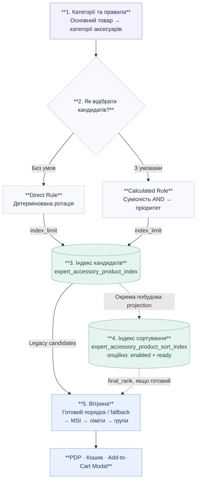

# Як працюють аксесуари: від правила до вітрини

> **Expert_Accessories · коротка схема архітектури**  
> Головне: **правила визначають кандидатів → індекси зберігають результат → вітрина перевіряє актуальну наявність і показує картки.**

## Схема обробки

> Якщо Mermaid не підтримується у переглядачі Markdown, короткий порядок: **правила → відбір → індекс кандидатів → [опційний індекс сортування] → MSI та групування → вітрина**.

## Три шари системи

| Шар | Що відбувається | Коли |
|---|---|---|
| **1. Формування кандидатів** | Direct Rule обирає товари стабільною ротацією; Calculated Rule застосовує обов'язкові фільтри (**AND**) та пріоритети. Результат зберігається в `expert_accessory_product_index`. | Під час rebuild |
| **2. Сортування** | Якщо окреме сортування увімкнено, projection упорядковує вже відібраних кандидатів за налаштованими критеріями та зберігає `final_rank` у `expert_accessory_product_sort_index`. **Нових товарів не додає.** | Після оновлення кандидатів, окремим процесом |
| **3. Вітрина** | `AccessoryGroupProvider` бере кандидатів, застосовує готовий `final_rank` лише за доступного стану `ready` (інакше — legacy порядок), перевіряє MSI, групує та застосовує `display_limit`. | Під час показу PDP, кошика або модального вікна |

## Звідки береться порядок карток

1. **Умови / ротація:** визначають склад набору та початковий `rank`. Пріоритетність не повертає несумісні товари.
2. **Sort Projection (якщо активна):** перебудовує порядок *наявних* кандидатів за щонайбільше трьома критеріями — наприклад, продажами, переглядами, ціною чи позицією в категорії. Один materialized порядок використовується для UA/RU Store Views.
3. **MSI на вітрині:** якщо «Виключати товари не в наявності» = **Так**, недоступні товари прибираються; якщо **Ні**, доступні йдуть першими, недоступні — після них. Усередині груп доступності зберігається індексний порядок.
4. **Групи та показ:** застосовується `display_limit` для кожної категорії аксесуарів. Вкладка **«Топ»** по черзі бере картки з готових груп; порядок різних категорій не змішується в один рейтинг.

**Важливо про ліміти:** `index_limit` — скільки кандидатів зберігати для пари *основний товар + правило*. `display_limit` — скільки карток показати в кожній групі на вітрині. Якщо після MSI-фільтрації товарів замало, вітрина не шукає заміну поза індексом.

## Короткий приклад

**Телевізор 55" → Кронштейни.** Для Calculated Rule умова `Входження в діапазон` залишає кронштейни `32"–65"` і виключає `19"–42"`. Сумісні товари потрапляють до індексу кандидатів. Якщо сортування налаштоване та готове, застосовується `final_rank`. Перед показом Magento повторно перевіряє їхню актуальну доступність через MSI.

## Що не потрібно плутати

- **Індекс кандидатів** відповідає на запитання: *які аксесуари підібрані?*
- **Індекс сортування** відповідає: *у якому порядку показувати підібрані аксесуари?* Він діє тільки за відповідних налаштувань і готового projection.
- **MSI / salability** відповідає: *чи можна купити аксесуар зараз?* Від нього також залежить runtime-фільтрація або availability-first порядок.

> **Статус і обмеження:** сортування в окремому projection керується прапорцем `expert_accessories/sorting/enabled` (за замовчуванням вимкнений). За відсутнього або неготового projection storefront використовує попередній порядок. Деталі rebuild, dirty markers, metric loaders і SQL-контрактів описані в повній технічній документації.
