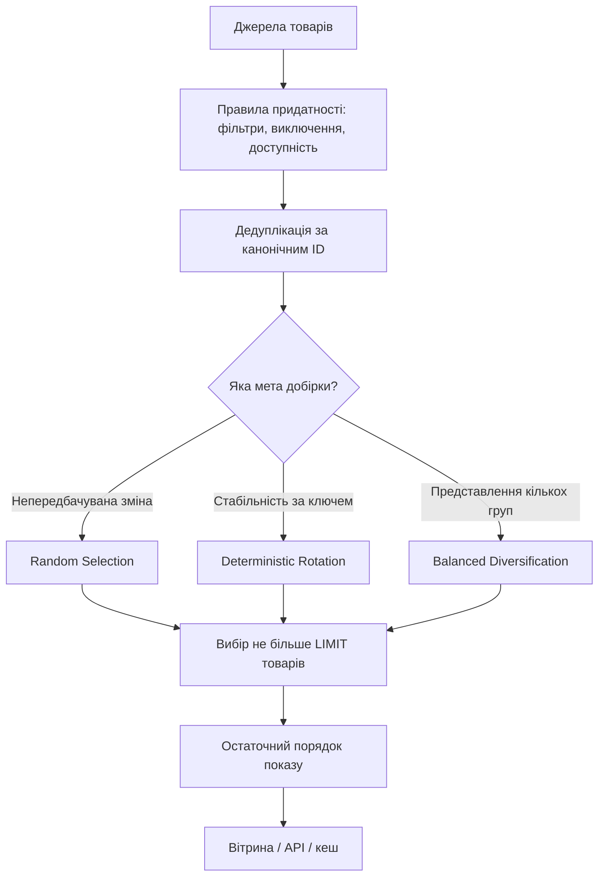
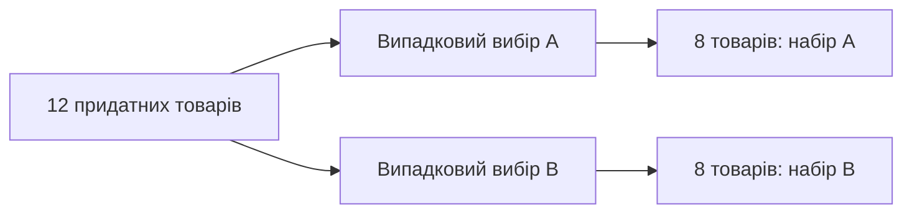
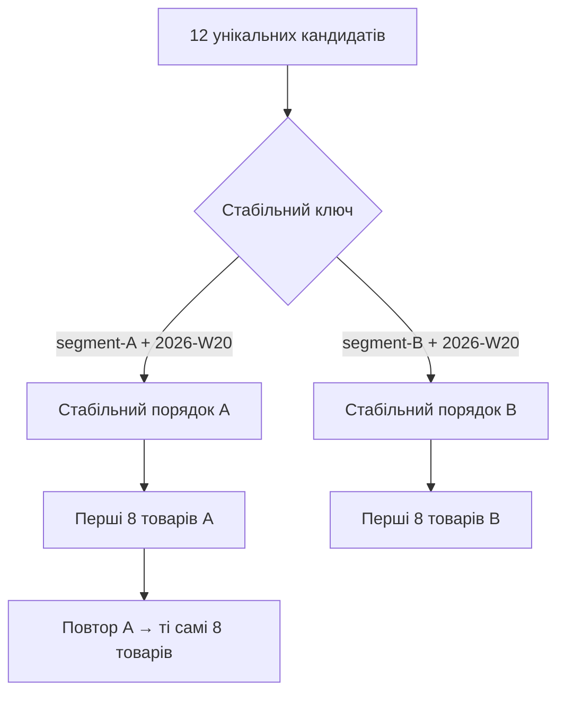
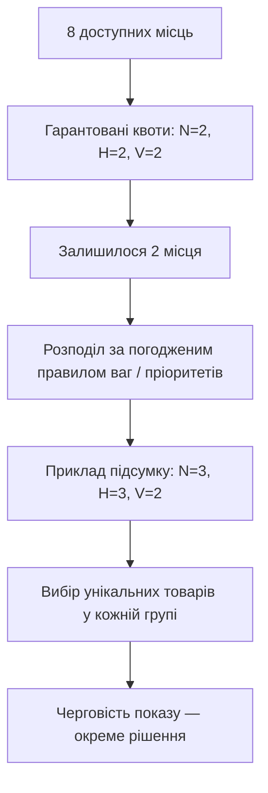
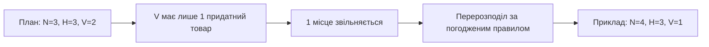
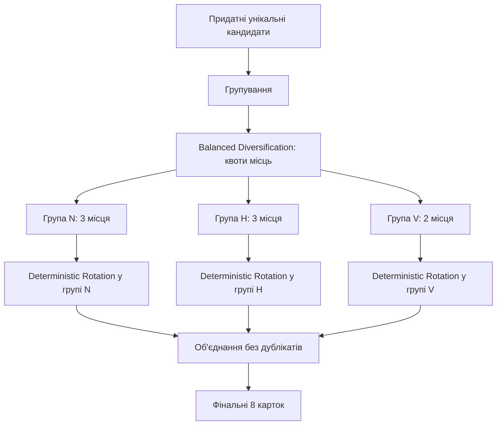
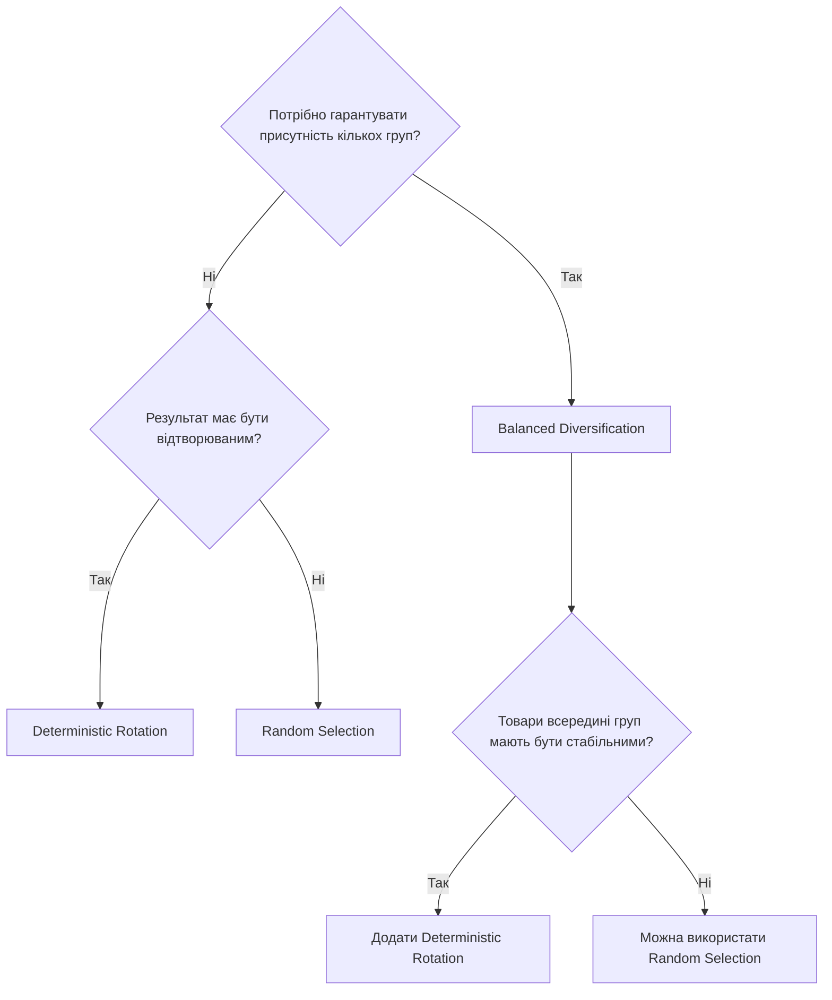

# Патерни розподілу товарів

## Призначення

Цей довідник описує три універсальні способи сформувати добірку товарів із
множини придатних кандидатів. Він задає правила проєктування для вітрин,
добірок, рекомендацій, промоблоків та інших сценаріїв, де потрібно показати
обмежену кількість товарних позицій. Документ не визначає конкретне сховище
даних, інструмент пошуку або спосіб реалізації.

Перед застосуванням патерна потрібно окремо визначити правила формування
кандидатів, доступність товарів, унікальність, пріоритети та потрібний розмір
результату.

## Спільні поняття та правила

| Поняття | Значення |
| --- | --- |
| Кандидат | Товар, який пройшов початкові правила відбору й може потрапити до результату. |
| Група | Логічна множина товарів: категорія, бренд, ціновий сегмент, тип товару, кампанія або інша ознака. |
| Місце | Одна позиція в результаті, наприклад одне з восьми місць у блоці. |
| `LIMIT` | Максимальна кількість товарів у фінальному результаті. Він обмежує результат, але не замінює правила розподілу. |
| Стабільний ключ | Незмінне для потрібного періоду значення, наприклад ідентифікатор відвідувача, сторінки, сегмента або календарного дня. |

### Унікальність товарів

У межах одного результату товар має бути унікальним за його канонічним
ідентифікатором. Якщо один товар належить до кількох груп або отриманий із
кількох джерел, його слід залишити лише один раз. Правило унікальності треба
застосувати до розподілу місць, інакше той самий товар може зайняти кілька
місць і порушити баланс.

### Пріоритети, ваги та наявність

Пріоритет визначає, чи повинен товар або група розглядатися раніше за інші.
Вага задає відносну частку або ймовірність: більша вага дає більше шансів на
відбір або більше місць, але не гарантує включення. Якщо потрібна гарантія,
вона має бути окремим правилом, наприклад «щонайменше один товар з групи A».

До кандидатів зазвичай потрапляють лише товари, доступні для показу та
продажу відповідно до бізнес-правил. Якщо доступність змінюється після
побудови добірки, недоступний товар прибирають, а вільне місце заповнюють
наступним придатним кандидатом за правилами обраного патерна. Не можна
замінювати його товаром, який не відповідає початковим фільтрам.

### Кандидати, місця та остаточне сортування

Це три різні етапи, які не слід змішувати.

1. **Підбір кандидатів** визначає, які товари взагалі дозволено показати:
   фільтри, доступність, виключення, дедуплікація та базові пріоритети.
2. **Розподіл місць** обирає до `LIMIT` товарів або визначає, скільки місць
   належить кожній групі. Саме тут застосовують описані патерни.
3. **Остаточне сортування** встановлює порядок уже обраних товарів, наприклад
   за пріоритетом, стабільним порядком або визначеним порядком місць.

Остаточне сортування не повинно непомітно скасовувати розподіл. Наприклад,
сортування всіх обраних товарів тільки за ціною може прибрати візуальний ефект
чергування груп, хоча склад результату залишиться збалансованим.

## 1. Random Selection — випадковий вибір

### Призначення

Патерн потрібний, коли добірка має регулярно змінюватися, а однакова
відповідь на повторні запити не є вимогою. Він дає всім придатним кандидатам
рівний шанс за відсутності ваг або шанс, пропорційний вазі, якщо вона задана.

### Принцип роботи

Після фільтрації та дедуплікації патерн випадково перемішує кандидатів або
випадково вибирає їх без повторів. Перші `LIMIT` товарів утворюють результат.
За наявності ваг випадковий вибір проводять так, щоб вагоміші товари мали
більшу ймовірність потрапити до вибірки.

### Вхідні дані

| Дані | Призначення |
| --- | --- |
| Множина унікальних кандидатів | Джерело товарів для вибору. |
| `LIMIT` | Кількість потрібних позицій. |
| Ваги товарів або груп, за потреби | Впливають на ймовірність вибору. |
| Правила доступності та виключення | Визначають, які товари допустимі. |

### Приклад вибору 8 товарів

Є дванадцять унікальних кандидатів: `P01`–`P12`. Для `LIMIT = 8` один запуск
може дати результат `P07, P02, P11, P04, P09, P01, P12, P05`. Інший запуск із
тими самими кандидатами може дати `P03, P12, P08, P01, P06, P10, P04, P09`.

### Повторні запити та кешування

Повторний запит може повертати інший результат. Це ускладнює кешування:
спільний кеш закріплює випадковий результат до завершення строку життя, а
відмова від кешу збільшує навантаження. Якщо зміна добірки має бути
контрольованою, варто застосувати короткий часовий інтервал як частину
джерела випадковості або обрати детермінований патерн.

### Переваги

- Простий спосіб забезпечити різноманітність показів.
- Не потребує збереження стану між запитами.
- Добре підходить для великої однорідної множини кандидатів.

### Недоліки

- Немає відтворюваності для одного й того самого запиту.
- Може надто часто показувати одні товари та довго не показувати інші.
- Складніше пояснювати результат, перевіряти його та ефективно кешувати.

### Підходящі сценарії

- Оновлювані промоблоки без персоналізованих гарантій.
- Дослідницькі добірки та випадкові вітрини.
- Ненав'язливе перемішування великого списку рівноцінних товарів.

## 2. Deterministic Rotation — детермінована ротація

### Призначення

Патерн потрібний, коли різним ключам слід показувати різні добірки, але для
однакового ключа результат має бути відтворюваним. Це дозволяє поєднати
різноманітність між ключами зі стабільністю в межах одного ключа.

### Принцип роботи

Стабільний ключ перетворюють на seed і на його основі створюють стабільний
порядок кандидатів. Перші `LIMIT` у цьому порядку утворюють результат. До
ключа можна додати контрольований період ротації, наприклад день або тиждень:
тоді добірка стабільна протягом періоду, а після його зміни оновлюється.

### Вхідні дані

| Дані | Призначення |
| --- | --- |
| Множина унікальних кандидатів | Джерело товарів для ротації. |
| `LIMIT` | Кількість потрібних позицій. |
| Стабільний ключ | Визначає конкретний відтворюваний варіант добірки. |
| Період ротації, за потреби | Керує моментом зміни добірки. |
| Правила доступності, ваги та пріоритети | Обмежують або впливають на порядок кандидатів. |

### Приклад вибору 8 товарів

Є ті самі кандидати `P01`–`P12` і `LIMIT = 8`. Для ключа `segment-A +
2026-W20` стабільний порядок може починатися так: `P04, P10, P01, P08, P12,
P03, P06, P11`; це й є результат. Для ключа `segment-B + 2026-W20` результат
може бути `P07, P02, P09, P05, P11, P01, P08, P04`. Повторний запит із першим
ключем повертає перший список, доки не зміняться кандидати або період ротації.

### Повторні запити та кешування

Той самий ключ, набір кандидатів і період ротації мають давати той самий
результат. Кеш треба розділяти щонайменше за ключем, періодом і версією
кандидатів або правил. Це робить кеш передбачуваним; водночас надто деталізований
ключ може зменшити його ефективність.

### Переваги

- Відтворюваний та пояснюваний результат.
- Різні ключі можуть отримувати різні добірки без випадковості на кожному запиті.
- Добре сумісний із кешуванням і перевіркою результатів.
- Дозволяє явно керувати частотою ротації.

### Недоліки

- Потрібно узгодити, що є стабільним ключем і коли він змінюється.
- Після зміни набору кандидатів склад добірки може змінитися навіть у межах періоду.
- Сам по собі не гарантує представлення кожної групи.

### Підходящі сценарії

- Стабільні персоналізовані або сегментні добірки.
- Ротація промотоварів за днями чи тижнями.
- Варіанти вітрини для сторінок, кампаній або аудиторій.

## 3. Balanced Diversification — збалансована диверсифікація

### Призначення

Патерн потрібний, коли обмежену кількість місць треба розподілити між кількома
групами так, щоб одна численна група не витіснила всі інші. Він керує складом
результату, а не лише випадковим порядком товарів.

### Принцип роботи

Спочатку визначають групи, їхні мінімальні гарантії, максимальні межі або
ваги. Потім `LIMIT` місць розподіляють між групами. Із кожної групи обирають
потрібну кількість унікальних доступних товарів. Якщо група не має достатньо
кандидатів, невикористані місця передають іншим придатним групам за заздалегідь
визначеним правилом. Вибір усередині групи може бути випадковим або
детермінованим.

### Вхідні дані

| Дані | Призначення |
| --- | --- |
| Унікальні кандидати з належністю до груп | Основа для розподілу. |
| `LIMIT` | Загальна кількість місць. |
| Правила часток | Мінімум, максимум або вага для кожної групи. |
| Правило перерозподілу | Визначає, куди перейти місцям від неповних груп. |
| Правило вибору в групі | Випадкове, детерміноване або пріоритетне. |
| Правила доступності та виключення | Обмежують придатних кандидатів. |

### Приклад вибору 8 товарів

Є три групи: `Новинки` (N), `Хіти` (H) і `Вигідні пропозиції` (V). Правило для
восьми місць: по два гарантовані місця кожній групі, два решта місця — за
вагами `N: 2`, `H: 1`, `V: 1`. Після розподілу виходить `N = 3`, `H = 3`,
`V = 2`. Результат може бути: `N01, H03, V02, N05, H07, V04, N02, H01`.
Черговість показу тут чергує групи, але вона є окремим кроком остаточного
сортування.

Якщо в групі `V` є лише один доступний товар, один її вільний слот слід
перерозподілити, наприклад до `N` за найбільшою вагою. Тоді склад буде
`N = 4`, `H = 3`, `V = 1` без дублювання товарів.

### Повторні запити та кешування

Повторюваність залежить від правила вибору в групі. Якщо воно випадкове,
патерн має властивості Random Selection; якщо детерміноване — властивості
Deterministic Rotation. Ключ кешу повинен враховувати правила групування,
квоти або ваги, доступність та правило вибору всередині групи.

### Переваги

- Гарантує видимість важливих груп у малому `LIMIT`.
- Запобігає монополізації добірки численною групою.
- Виражає бізнес-пріоритети через квоти, межі та ваги.

### Недоліки

- Потребує чітких правил для неповних груп і конфліктів ваг.
- Складніший для пояснення та тестування, ніж простий вибір.
- Може знизити релевантність, якщо баланс важливіший за єдиний глобальний рейтинг.

### Підходящі сценарії

- Вітрина з різними типами товарів або кампаніями.
- Добірка, де потрібно представити кілька брендів, категорій чи цінових сегментів.
- Результати, у яких важливі одночасно різноманітність і контрольований склад.

## Порівняння патернів

| Критерій | Random Selection | Deterministic Rotation | Balanced Diversification |
| --- | --- | --- | --- |
| Головна мета | Випадкова різноманітність | Стабільна ротація за ключем | Представлення кількох груп |
| Результат за повторного запиту | Зазвичай змінюється | Однаковий за тих самих входів | Залежить від вибору в групах |
| Роль стабільного ключа | Необов'язкова | Обов'язкова | Необов'язкова, але корисна для вибору в групах |
| Гарантія частки групи | Немає | Немає | Є, якщо задані квоти або межі |
| Кешування | Обережно: результат може закріпитися випадково | Ефективне за ключем і періодом | Залежить від правил квот і вибору в групах |
| Складність | Низька | Середня | Середня або висока |
| Типовий ризик | Нерівномірна видимість товарів | Невдалий вибір ключа або періоду | Неповні групи та складний перерозподіл |

## Комбінування патернів

Патерни можна поєднувати, якщо межі відповідальності лишаються явними.
Найпоширеніші комбінації:

- Balanced Diversification розподіляє місця між групами, а Random Selection
  вибирає товари в межах кожної групи.
- Balanced Diversification розподіляє місця, а Deterministic Rotation стабільно
  вибирає товари в межах групи для заданого ключа.
- Deterministic Rotation встановлює стабільний порядок кандидатів, після чого
  Balanced Diversification бере з нього потрібну кількість товарів кожної групи.

Потрібно зафіксувати порядок комбінування в вимогах. Інакше одна команда може
спочатку обрати товари глобально, а інша — спочатку розподілити місця, і ці
підходи дадуть різні результати.

## Як вибрати патерн

| Потреба майбутньої задачі | Рекомендований патерн |
| --- | --- |
| Кожен показ має давати нову, необов'язково відтворювану добірку | Random Selection |
| Той самий відвідувач, сторінка або сегмент має бачити стабільний результат протягом періоду | Deterministic Rotation |
| У малому блоці обов'язково мають бути товари з кількох груп | Balanced Diversification |
| Потрібні і баланс груп, і стабільність результату | Balanced Diversification + Deterministic Rotation |
| Потрібні і баланс груп, і постійна зміна товарів | Balanced Diversification + Random Selection |

Для кожної нової задачі слід до початку реалізації письмово визначити:

1. джерело та фільтри кандидатів;
2. канонічний ідентифікатор для дедуплікації;
3. `LIMIT` і поведінку, якщо кандидатів менше;
4. правила доступності, пріоритети, ваги та групи;
5. потрібну детермінованість і, за потреби, стабільний ключ та період ротації;
6. правило перерозподілу вільних місць;
7. остаточний порядок показу та складові ключа кешу.


---

## Візуальний атлас: як працюють три патерни

> Цей розділ доповнює визначення вище. Усі набори товарів та результати нижче — **навчальні приклади**, а не результати конкретного програмного модуля. `P01`–`P12` — умовні унікальні товари.

### 1. Спільний конвеєр формування добірки



**Важливо:** фільтрація кандидатів, розподіл місць та остаточний порядок показу — різні операції. Патерн не повинен обходити правила сумісності, доступності або унікальності.

### 2. Random Selection: випадковість між запитами

У пулі є 12 товарів, потрібно показати 8. Для однакових кандидатів два незалежні запити можуть отримати різні набори:

| Позиція | 1 | 2 | 3 | 4 | 5 | 6 | 7 | 8 |
|---|---|---|---|---|---|---|---|---|
| Запит A | P07 | P02 | P11 | P04 | P09 | P01 | P12 | P05 |
| Запит B | P03 | P12 | P08 | P01 | P06 | P10 | P04 | P09 |



**Що гарантується:** не більше `LIMIT` унікальних кандидатів за умови вибору без повторів. **Що не гарантується:** новий склад на кожному запиті, рівномірна кількість показів кожного товару або представлення кожної групи.

### 3. Deterministic Rotation: різні ключі, відтворюваний результат

Однаковий набір кандидатів і той самий ключ дають однакову добірку, якщо правила та дані не змінювалися.



| Позиція | 1 | 2 | 3 | 4 | 5 | 6 | 7 | 8 |
|---|---|---|---|---|---|---|---|---|
| Ключ A | P04 | P10 | P01 | P08 | P12 | P03 | P06 | P11 |
| Повтор ключа A | P04 | P10 | P01 | P08 | P12 | P03 | P06 | P11 |
| Ключ B | P07 | P02 | P09 | P05 | P11 | P01 | P08 | P04 |

**Модель відтворюваності:**

```text
Однакові кандидати + однакові правила + однаковий ключ
                         ↓
              Однаковий порядок
                         ↓
                Однаковий TOP 8
```

Ключ може включати сторінку, товар, сегмент або період, **але період не є обов'язковим**. Якщо до ключа не додано дату чи тиждень, ротація не означає автоматичну щоденну зміну. Зміна складу кандидатів також може змінити результат.

**Межа патерна:** він забезпечує відтворюваність вибору, але не гарантує, що вісім місць будуть розподілені між різними категоріями.

### 4. Balanced Diversification: спочатку місця для груп

Нехай є три групи товарів: **N — новинки**, **H — хіти**, **V — вигідні пропозиції**. Блок має `LIMIT = 8`.



| Етап | Новинки N | Хіти H | Пропозиції V | Усього |
|---|---:|---:|---:|---:|
| Мінімальні квоти | 2 | 2 | 2 | 6 |
| Додаткові місця, **приклад** | +1 | +1 | +0 | +2 |
| Фінальний склад | **3** | **3** | **2** | **8** |

> Ваги `N:2, H:1, V:1` самі по собі не визначають однозначно, кому дістануться два неподільні місця: потрібно окремо встановити правило округлення та розв'язання рівності. Наведений розподіл `3/3/2` — один із можливих результатів за заздалегідь визначеним правилом.

**Один із можливих порядків показу:**

| Місце | 1 | 2 | 3 | 4 | 5 | 6 | 7 | 8 |
|---|---|---|---|---|---|---|---|---|
| Група | N | H | V | N | H | V | N | H |
| Товар | N01 | H03 | V02 | N05 | H07 | V04 | N02 | H01 |

Розподіл місць **3/3/2** та порядок **N–H–V–N–H–V–N–H** — не одне й те саме. Можна зберегти склад груп, але відсортувати картки інакше.

#### Якщо одна група не має достатньо товарів

Припустимо, у групі V доступний лише один товар:



Вільне місце отримує лише **придатний унікальний товар** з іншої групи. Якщо придатних кандидатів немає, блок може містити менше восьми карток.

### 5. Чим відрізняється різноманітність між сторінками від балансу всередині блоку

| Питання | Random | Deterministic Rotation | Balanced Diversification |
|---|---|---|---|
| Чи можуть дві сторінки отримати різні добірки? | Так, випадково | Так, за різних ключів | Так, залежно від кандидатів і внутрішнього вибору |
| Чи повториться результат для того самого ключа? | Не гарантовано | Так, за незмінних входів | Лише за детермінованих правил |
| Чи можна гарантувати місце кожній важливій групі? | Ні | Ні | Так, якщо квоти здійсненні |
| Чи може одна велика група зайняти весь блок? | Так | Так | Можна запобігти квотами / обмеженнями |
| Чи можна комбінувати з іншим патерном? | Так | Так | Так |

### 6. Комбінація: Balanced Diversification + Deterministic Rotation

Це **композиція двох відповідальностей**, а не четвертий базовий патерн:



Результат: **баланс груп** і **стабільний вибір конкретних товарів**. Якщо один товар входить до кількох груп, правило закріплення товару за групою потрібно визначити до розподілу, щоб не зайняти два місця одним товаром.

### 7. Швидка схема вибору для нової задачі



### 8. Контрольний приклад для постановки задачі

Перед реалізацією будь-якого патерна варто заповнити таку таблицю:

| Параметр | Що потрібно визначити |
|---|---|
| Джерело кандидатів | Звідки беруться товари та які фільтри обов'язкові |
| Ідентичність | За яким ID прибираються дублікати |
| `LIMIT` | Максимум карток і поведінка за нестачі кандидатів |
| Групи | Чи потрібне представлення різних категорій, брендів, типів |
| Квоти / ваги | Мінімум, максимум, частки та правила округлення |
| Стабільний ключ | Що робить результат відтворюваним |
| Період | Чи потрібна ротація за часом |
| Наявність | Фільтрація або сортування недоступних товарів |
| Пріоритети | Які обмеження не можна порушувати |
| Порядок показу | Чи потрібно чергувати групи |
| Кеш | За якими входами розрізняються результати |
| Тести | Повторюваність, відсутність дублікатів, нестача кандидатів, порожні групи |

**Ключовий висновок:** `Random Selection` відповідає за випадковість, `Deterministic Rotation` — за відтворювану варіативність, а `Balanced Diversification` — за контроль представлення груп. Для складних добірок ці властивості можна комбінувати.
