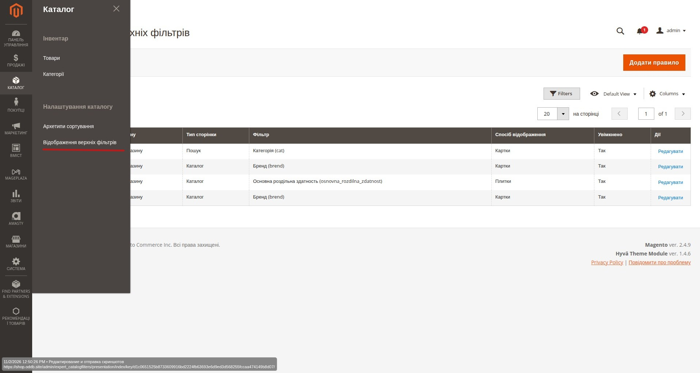
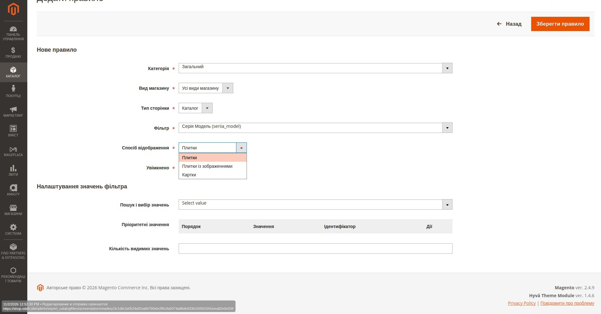
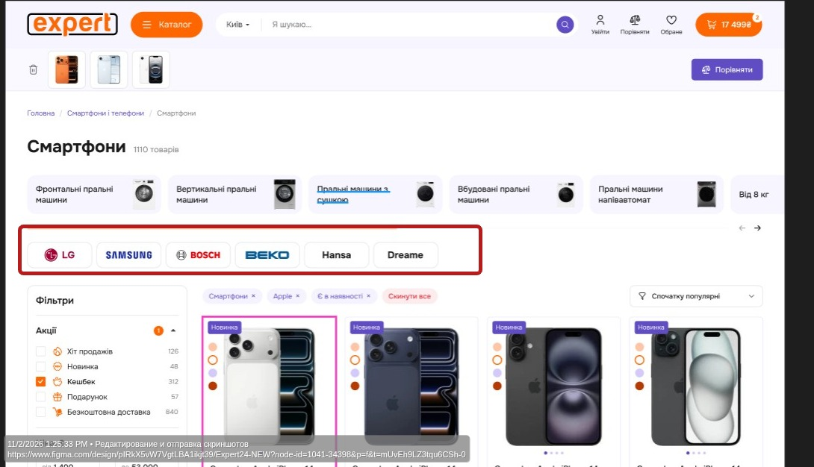
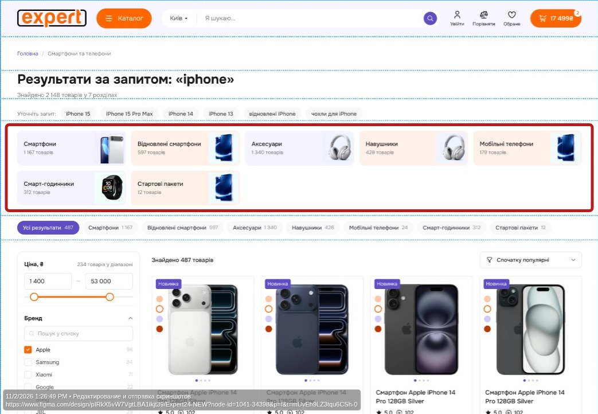
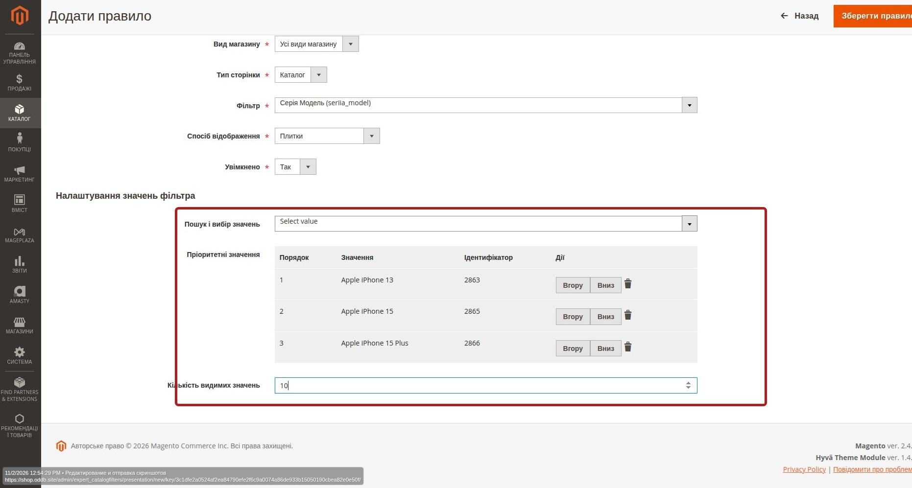
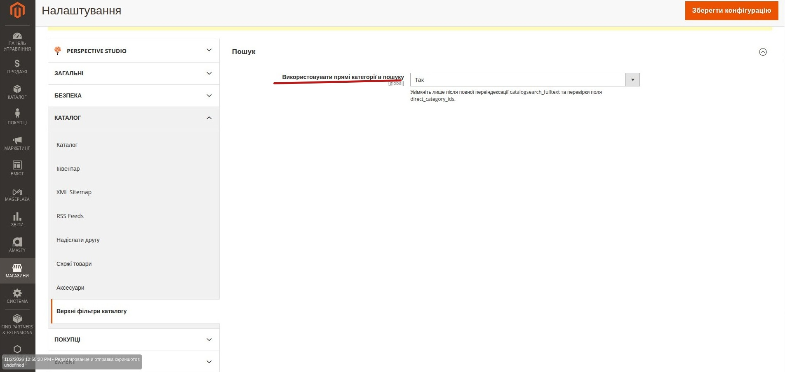

# Інструкція менеджера: налаштування верхніх фільтрів каталогу

> **Для кого:** контент-менеджер, категорійний менеджер, адміністратор каталогу.  
> **Мета:** створювати правила відображення верхніх фільтрів на сторінках категорій і пошуку без змін програмного коду.

## 1. Де знайти налаштування

У панелі адміністратора Magento відкрийте:

**Каталог → Налаштування каталогу → Відображення верхніх фільтрів**.

Відкриється таблиця наявних правил. Для створення нового натисніть **«Додати правило»**. Для зміни наявного — **«Редагувати»** у відповідному рядку.

*Рис. 1. Перехід до розділу та список налаштованих правил.*

> Верхні фільтри — це окремий блок над списком товарів. Вони не замінюють стандартні фільтри Amasty в бічній панелі та не змінюють склад товарів самі по собі.

## 2. Створення правила: крок за кроком

Нижче показано форму створення правила з основними полями та способами відображення.

*Рис. 2. Основні параметри нового правила: категорія, вид магазину, тип сторінки, фільтр, спосіб відображення та стан.*

### Крок 1. Виберіть категорію

У полі **«Категорія»** вкажіть:

- **«Загальний»** — правило для всіх категорій, для яких немає точнішого правила;
- **конкретну категорію** — правило лише для відповідного категорійного контексту.

На сторінці **«Каталог»** контекстом є відкрита категорія. На сторінці **«Пошук»** категорійний контекст з'являється, коли користувач вибрав одну коректну категорію у фільтрі `cat`. Без вибраної категорії застосовуються загальні правила пошуку.

### Крок 2. Виберіть вид магазину

У полі **«Вид магазину»** вкажіть:

- **«Усі види магазину»** — спільне правило для UA та RU;
- **конкретний Store View** — правило лише для вибраної мовної версії.

Якщо оформлення однакове для обох мов, зазвичай достатньо **«Усі види магазину»**.

### Крок 3. Виберіть тип сторінки

| Значення | Де працює правило |
| --- | --- |
| **Каталог** | Сторінка категорії зі списком товарів (PLP). |
| **Пошук** | Сторінка результатів пошуку. |

Це незалежні типи сторінок: правило для каталогу автоматично не з'явиться на пошуку, і навпаки.

### Крок 4. Виберіть фільтр

У полі **«Фільтр»** виберіть потрібний атрибут, наприклад **«Бренд (brend)»**, **«Серія Модель (seriia_model)»** або **«Основна роздільна здатність»**.

Окремий системний варіант **«Категорія (cat)»** призначений для верхнього фільтра на сторінці пошуку. Для нього застосовується спосіб відображення **«Картки»**.

> Правило керує представленням уже доступного фільтра. Якщо Amasty не повертає відповідний фільтр або його значення для поточної вибірки, створення правила не додасть їх штучно.

### Крок 5. Виберіть спосіб відображення

| Спосіб | Для чого використовувати |
| --- | --- |
| **Плитки** | Компактний перелік текстових значень. |
| **Плитки із зображеннями** | Значення, для яких у поточній конфігурації доступне відповідне зображення. |
| **Картки** | Значення у форматі карток; зокрема використовується для категорій на пошуку. |

Обирайте спосіб відповідно до того, як потрібно показати варіанти покупцю. Наявність зображень залежить від даних і налаштувань відповідного фільтра, а не лише від цього перемикача.

### Як виглядають верхні фільтри на сайті

Верхні фільтри відображаються над списком товарів і допомагають покупцям швидко перейти до потрібної групи товарів або вибрати значення фільтра.

Зовнішній вигляд залежить від налаштованого правила, типу сторінки та способу відображення.

#### Верхній фільтр на сторінці каталогу   тип - "Плитки із зображеннями"

#### Верхній фільтр на сторінці пошуку  тип "Картки"

*Картки категорій над результатами пошуку.*

### Крок 6. Увімкніть правило

У полі **«Увімкнено»** встановіть **«Так»**. Значення **«Ні»** вимикає тільки це правило верхнього блока, а не сам фільтр Amasty.

### Крок 7. За потреби налаштуйте значення фільтра

У секції **«Налаштування значень фільтра»** доступні:

- **«Пошук і вибір значень»** — знайти та додати значення атрибута до пріоритетного списку;
- **«Пріоритетні значення»** — таблиця вибраних значень із порядком, ідентифікатором та діями;
- **«Кількість видимих значень»** — максимальна кількість звичайних значень, які сервер виводить у верхньому блоці.

Пріоритетні значення застосовуються до фільтрів типу select/multiselect. Для системного `cat` цей механізм недоступний.

### Крок 8. Збережіть і перевірте

Натисніть **«Зберегти правило»**. Потім відкрийте відповідну сторінку магазину, перевірте правильний Store View, вигляд верхнього блока та роботу переходів за значеннями.

Зміни звичайного правила автоматично скидають відповідний кеш представлення; переіндексація товарів для редагування порядку або ліміту не потрібна.

## 3. Як працюють пріоритетні значення

Приклад: у фільтрі **«Серія Модель»** менеджер вибрав:

| Порядок | Значення | ID значення |
| ---: | --- | ---: |
| 1 | Apple iPhone 13 | 2863 |
| 2 | Apple iPhone 15 | 2865 |
| 3 | Apple iPhone 15 Plus | 2866 |

Це приклад із поточної форми налаштування. Ідентифікатор потрібен системі; менеджеру достатньо орієнтуватися на назву.

*Рис. 3. Пріоритетні моделі, їхній порядок, ідентифікатори та поле «Кількість видимих значень».*

Для зміни порядку використовуйте кнопки **«Вгору»** та **«Вниз»**. Для видалення зі списку пріоритетів — значок кошика. Видалення з таблиці **не видаляє значення атрибута з Magento**.

**Принцип сортування:** спочатку йдуть доступні пріоритетні значення в заданому порядку, потім усі інші доступні значення в порядку, який надає Amasty.

Наприклад, якщо у поточній вибірці доступні `Apple iPhone 15`, `Apple iPhone 15 Plus`, `Apple iPhone 16` та `Apple iPhone 13`, вони відображатимуться як:

1. Apple iPhone 13
2. Apple iPhone 15
3. Apple iPhone 15 Plus
4. Apple iPhone 16

Якщо певної моделі немає серед доступних значень поточної вибірки, пріоритет **не змушує її з'явитися**.

## 4. Кількість видимих значень

Поле **«Кількість видимих значень»** визначає, скільки значень атрибута виводити у верхньому блоці після сортування.

| Значення поля | Результат |
| --- | --- |
| Порожньо | Без обмеження. |
| `0` | Без обмеження. |
| `10` | Показати перші 10 значень після пріоритетного сортування. |

Наприклад, менеджер задав три пріоритетні моделі й ліміт `10`: спочатку будуть ці три моделі (якщо вони доступні), далі — до семи інших значень Amasty.

**Важливо:** це серверний ліміт. Кнопки «Показати всі» у верхньому блоці немає; решта значень не виводиться в HTML цього блока. Якщо покупець уже вибрав значення за межами ліміту, воно залишається видимим, щоб його можна було зняти.

Ліміт застосовується до EAV-фільтрів, а не до системного фільтра категорій `cat`.

## 5. Готові приклади налаштування

### Приклад А. Бренди на сторінці телевізорів

| Поле | Значення |
| --- | --- |
| Категорія | Телевізори |
| Вид магазину | Усі види магазину |
| Тип сторінки | Каталог |
| Фільтр | Бренд (`brend`) |
| Спосіб відображення | Картки або плитки із зображеннями |
| Увімкнено | Так |
| Пріоритетні значення | Наприклад, Samsung → LG → Sony |
| Кількість видимих значень | Наприклад, `8` |

Результат: у верхньому блоці категорії «Телевізори» доступні бренди з'являються у вибраному форматі, а пріоритетні бренди — першими.

### Приклад Б. Моделі смартфонів

| Поле | Значення |
| --- | --- |
| Категорія | Потрібна категорія смартфонів або Загальний |
| Вид магазину | Усі види магазину |
| Тип сторінки | Каталог |
| Фільтр | Серія Модель (`seriia_model`) |
| Спосіб відображення | Плитки |
| Увімкнено | Так |
| Пріоритетні значення | Apple iPhone 13 → Apple iPhone 15 → Apple iPhone 15 Plus |
| Кількість видимих значень | `10` |

Результат: менеджер контролює порядок перших моделей, але їхня фактична доступність визначається поточною вибіркою товарів.

### Приклад В. Категорії у результатах пошуку

| Поле | Значення |
| --- | --- |
| Категорія | Загальний |
| Вид магазину | Усі види магазину |
| Тип сторінки | Пошук |
| Фільтр | Категорія (`cat`) |
| Спосіб відображення | Картки |
| Увімкнено | Так |

Результат: на сторінці пошуку з'являються картки категорій. Якщо адміністратор системи вже ввімкнув режим прямих категорій після переіндексації, у верхньому блоці враховуються лише прямі призначення товарів до категорій.

> **Менеджеру не потрібно перемикати режим прямих категорій для кожного правила.** Це окреме глобальне системне налаштування, а не поле форми правила.

## 6. Яке правило має перевагу

Якщо для того самого фільтра є кілька правил, система обирає найточніше за категорією та Store View:

| Пріоритет | Категорія | Вид магазину |
| ---: | --- | --- |
| 1 — найвищий | Конкретна | Конкретний |
| 2 | Конкретна | Усі |
| 3 | Загальний | Конкретний |
| 4 — базовий | Загальний | Усі |

**Приклад:** глобальне правило показує бренди плитками, а для категорії «Телевізори» створено правило з картками. На сторінці телевізорів застосовується правило категорії, а в інших категоріях — глобальне.

Не потрібно створювати дублікати з однаковою комбінацією категорії, Store View, типу сторінки й фільтра: система не дозволяє зберегти таке повторення.

## 7. Редагування та вимкнення правил

Щоб змінити правило, відкрийте його через **«Редагувати»**, змініть параметри й натисніть **«Зберегти правило»**.

Якщо потрібно тимчасово прибрати фільтр із верхнього блока, встановіть **«Увімкнено» → «Ні»**. Це безпечніше, ніж видаляти правило, яке може знадобитися пізніше.

Вимкнення правила не видаляє атрибут, не прибирає товари з каталогу та не вимикає стандартний фільтр Amasty.

## 8. Перевірка після збереження

- [ ] Відкрито правильний тип сторінки: **Каталог** або **Пошук**.
- [ ] Вибрано правильну категорію або перевірено загальне правило.
- [ ] Перевірено потрібний Store View: UA, RU або обидва.
- [ ] Верхній блок відображає потрібний фільтр і спосіб представлення.
- [ ] Пріоритетні значення йдуть у правильному порядку, якщо вони доступні.
- [ ] Ліміт значень працює очікувано.
- [ ] Натискання значення застосовує фільтр.
- [ ] Вибране значення можна скасувати.
- [ ] Після AJAX-фільтрації верхній блок оновлюється коректно.

## 9. Поширені запитання

**Чому після збереження фільтр не з'явився?**  
Перевірте, чи правило увімкнене, чи збігаються категорія, Store View і тип сторінки. Також фільтр повинен бути доступним у поточній вибірці Amasty й мати відповідні значення.

**Чому пріоритетне значення не показується?**  
Пріоритет змінює порядок, але не додає значення, якого немає в поточному facet Amasty.

**Чому відображається менше значень, ніж указано в ліміті?**  
Ліміт — це максимум, а не мінімум. Якщо доступно лише шість значень, встановлення `10` не створить ще чотири.

**Чому моє правило не застосувалося?**  
Можливо, існує точніше правило для цієї категорії або Store View. Перевірте таблицю пріоритетів вище.

**Чи потрібно переіндексувати товари після зміни порядку або ліміту?**  
Ні. Для звичайних змін правил кеш представлення оновлюється автоматично.

**Де налаштовується режим прямих категорій для пошуку?**  
Це системний перемикач **Магазини → Налаштування → Каталог → Верхні фільтри каталогу → Пошук → «Використовувати прямі категорії в пошуку»**. Його змінює технічний адміністратор після перевірки пошукового індексу. Менеджеру для створення правила `cat` цей параметр змінювати не потрібно.

*Рис. 4. Глобальний перемикач режиму прямих категорій у конфігурації Magento.*

**Чи впливає правило на стандартні фільтри зліва?**  
Ні. Правило керує лише верхнім представленням.

*Цей документ описує налаштування, підтверджені поточною документацією `Expert_CatalogFilters` та прикладами адміністративного інтерфейсу. Фактична наявність значень фільтрів на вітрині залежить від даних каталогу й Amasty Shopby.*
