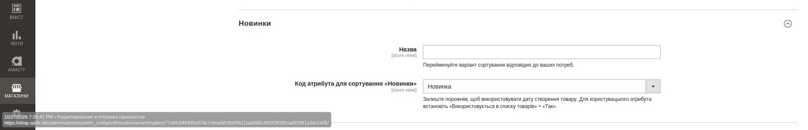
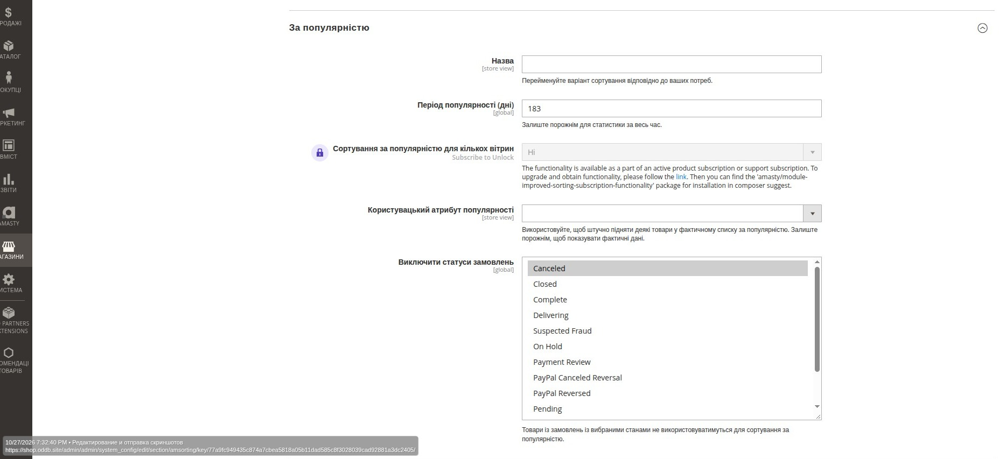

# Сортування товарів у Magento — інструкція адміністратора

> **Модулі:** Magento 2.4.9, Amasty Improved Sorting, Expert_Catalog.
> **Призначення:** налаштування сортування товарів у категоріях, окремих правил пошуку та перенесення архетипів між середовищами.
> **Мова інтерфейсу:** українська; окремі назви полів Amasty залишаються англійською.

## 1. Як працює сортування

У системі є два рівні налаштувань для **сторінок категорій (PLP)**:

| Рівень | Де налаштовується | Коли діє |
| --- | --- | --- |
| Глобальна послідовність Amasty | **Глобальні налаштування** → Amasty Improved Sorting | Категорія **не має** призначеного архетипу |
| Архетип сортування Expert_Catalog | **Каталог → Налаштування каталогу → Архетипи сортування** | Категорія має призначений архетип |

**Архетип має пріоритет над глобальною послідовністю для категорій.** Він задає до трьох послідовних критеріїв: **Спочатку сортувати за → Потім за → Потім за**. Наступний критерій використовується для товарів з однаковим значенням попереднього.

Архетип діє на основний список товарів сторінки категорії. Він **не** керує результатами пошуку, автодоповненням, рекомендаціями, CMS-блоками або сторінкою товару (PDP). Якщо покупець явно вибирає спосіб сортування на панелі сортування, цей вибір має пріоритет; другий і третій критерії архетипу до ручного вибору не додаються.

## 2. Де знайти налаштування

В адміністративній панелі відкрийте **Каталог → Налаштування каталогу → Архетипи сортування**. Розділ «Інвентар» залишається окремим.

На сторінці архетипів доступні: **Експорт JSON**, **Імпорт JSON**, **Глобальні налаштування** і **Додати архетип**.

**Глобальні налаштування** відкривають конфігурацію **Amasty Improved Sorting** у поточній адміністративній панелі. Адреса формується Magento автоматично; її не потрібно копіювати між середовищами. Доступ до кнопки залежить від дозволу `Amasty_Sorting::config`.

## 3. Глобальні налаштування Amasty Improved Sorting

У конфігурації Amasty визначаються доступні методи, їхній порядок на панелі сортування, напрямки сортування та стандартні послідовності для категорій і пошуку.

### 3.1. Загальні параметри

| Параметр | Що означає |
| --- | --- |
| **Вимкнути сортування за** | Приховує метод із ручного вибору покупця. Приховування не тотожне забороні його використання в архетипі. Expert_Catalog враховує призначені архетипи для індексації потрібних методів. |
| **Порядок сортування** | Порядок доступних покупцеві способів на панелі сортування. Це **не** послідовність «Спочатку сортувати за → Потім за → Потім за». |
| **Сортувати атрибути за спаданням за замовчуванням** | Методи, для яких за замовчуванням застосовується напрямок `DESC`. |
| **Сортування за замовчуванням на сторінках категорій** | Запасна послідовність для категорій без архетипу. |
| **Сортування за замовчуванням на сторінках пошуку** | Окрема послідовність для сторінок результатів пошуку. |
| **Використовувати у спливному вікні пошуку** | Визначає, чи використовує спливне вікно пошуку налаштоване сортування пошуку; його поведінку потрібно перевіряти окремо. |

### 3.2. Послідовність для категорій

У **Сортування за замовчуванням на сторінках категорій**:

1. **Спочатку сортувати за** — основний критерій.
2. **Потім за** — додатковий критерій.
3. Друге поле **Потім за** — третій критерій.

Не задавайте третій критерій без другого. Для категорії з архетипом глобальна послідовність замінюється його послідовністю.

### 3.3. Значення методів

#### Критерії Amasty Improved Sorting

Довідкова таблиця критеріїв сортування Amasty Improved Sorting із відповідними українськими назвами та поясненнями.

| Код | Назва в Amasty | Українська назва | Опис |
|---|---|---|---|
| `position` | Position | Позиція в категорії | Порядок товарів у категорії. |
| `name` | Product Name | Назва товару | Сортування товарів за назвою. |
| `price` | Price | Ціна | Сортування товарів за ціною. |
| `revenue` | Revenue | За виручкою | За сумою продажів у грошовому вираженні. |
| `most_viewed` | Most Viewed | За переглядами | За кількістю переглядів товару. |
| `wished` | Now in Wishlists | Найчастіше додані до обраного | За кількістю додавань товару до списків бажань. |
| `reviews_count` | Reviews Count | За кількістю відгуків | За кількістю відгуків покупців. |
| `rating_summary` | Top Rated | За рейтингом | За рейтингом товару. |
| `new` | New | Новинки | За ознакою новизни товару. |
| `stock_quantity` | Stock Quantity | За кількістю на складі | За кількістю одиниць товару на складі. |
| `saving` | Biggest Saving | Найбільша економія | За величиною економії від знижки. |
| `price_asc` | Price: low to high | Від дешевих до дорогих | Від найдешевших до найдорожчих товарів. |
| `price_desc` | Price: high to low | Від дорогих до дешевих | Від найдорожчих до найдешевших товарів. |
| `bestsellers` | Best Sellers | За популярністю | За кількістю проданих одиниць товару. |

> **Примітка:** таблиця містить усі 14 варіантів із налаштувань Amasty Improved Sorting. Вона є загальним довідником термінів і не визначає, які критерії підтримує конкретний модуль Magento.

Напрямок `ASC/DESC` не задається окремо в архетипі: використовується налаштування відповідного методу Amasty.

### 3.4. Налаштування сортування «Новинки»

Метод **Новинки** використовується для сортування товарів за новизною.

Джерело сортування налаштовується в **Amasty Improved Sorting → Новинки** через поле **Код атрибута для сортування «Новинки»**.

Система підтримує два варіанти:

| Налаштування | Джерело сортування |
| --- | --- |
| **Атрибут вибрано** | Використовується значення вибраного атрибута Magento. |
| **Атрибут не вибрано** | Використовується дата створення товару (`created_at`). Новіші товари відображаються першими. |

У поточній конфігурації вибрано атрибут **«Новинка»**.

**Важливо:**

- Для вибраного атрибута необхідно встановити **Використовується у списку товарів = Так**.
- Якщо поле **Код атрибута для сортування «Новинки»** залишити порожнім, Amasty автоматично використовує дату створення товару.
- Налаштування визначає джерело сортування **Новинки**, а не автоматично присвоює товару статус «Новинка».
- Метод **Новинки** можна використовувати як один із критеріїв сортування в архетипах **Expert_Catalog**.

###  3.5. Налаштування сортування  «За популярністю»

Метод **За популярністю** використовує статистику продажів. Поле **Період популярності (дні)** обмежує розрахунок замовленнями за вказаний проміжок: значення `183` означає останні 183 дні. Замовлення зі статусами, вибраними в полі **Виключити статуси замовлень**, до розрахунку не потрапляють.

Популярність товару дорівнює сумі замовлених одиниць `SUM(qty_ordered)`, а не кількості замовлень. Якщо **Користувацький атрибут популярності** не вибрано, товари сортуються за цією сумою. Якщо атрибут вибрано, спочатку застосовується його значення за спаданням, а за однакових значень — кількість проданих одиниць. Значення атрибута та продажі не додаються одне до одного.

| Товар | Продано одиниць | Атрибут популярності |
| --- | ---: | ---: |
| A | 50 | 2 |
| B | 10 | 10 |
| C | 30 | 5 |

Без атрибута порядок: **A → C → B**.

З атрибутом порядок: **B → C → A**.

Статистика продажів зберігається в індексі Amasty та оновлюється під час переіндексації; для цього також передбачено плановий запуск через cron.

## 4. Список архетипів

Таблиця показує назву архетипу, три критерії, призначені категорії, кількість категорій та останню колонку **«Дія»**.

У колонці **Дія → Вибрати** доступні **Редагувати** і **Видалити**. Якщо порядок стовпців відрізняється, перевірте персональне подання таблиці (**Подання за замовчуванням / Стовпці**): Magento може зберігати його в закладках інтерфейсу.

**Важливо:** зміна спільного архетипу впливає одразу на **всі** призначені категорії.

## 5. Створення нового архетипу

1. На сторінці списку натисніть **Додати архетип**.
2. У полі **Назва** вкажіть зрозумілу назву для адміністраторів.
3. У полі **Спочатку сортувати за** виберіть обов'язковий перший критерій.
4. За потреби задайте другий і третій критерії в полях **Потім за**.
5. У блоці **Призначені категорії** знайдіть і виберіть потрібні категорії.
6. Перевірте список призначень і натисніть **Зберегти**.

Один архетип може бути призначений багатьом категоріям, але **одна категорія може належати лише одному архетипу**. Призначення батьківської категорії **не поширюється автоматично** на дочірні. Повторювати один метод у межах однієї послідовності не потрібно.

## 6. Редагування архетипу та категорій

Відкрийте **Дія → Редагувати**. Можна змінити назву, послідовність критеріїв і список категорій. Для додавання категорії використовуйте поле пошуку; для вилучення — іконку кошика в її рядку. Після перевірки натисніть **Зберегти**.

У прикладі на скриншоті архетип **«Телевізори і велика техніка»** має послідовність **За переглядами → Найбільша економія → Від дешевих до дорогих** та призначений категоріям **308, 428, 569, 607**. Це **приклад фактичної конфігурації на момент знімка**, а не універсальна рекомендація для всіх категорій.

Якщо категорія вже належить іншому архетипу, система не перепризначає її автоматично. Спочатку потрібно свідомо вилучити призначення з попереднього архетипу.

## 7. Імпорт та експорт JSON

**Експорт JSON** і **Імпорт JSON** переносять архетипи разом із призначеннями категорій. **Глобальна конфігурація Amasty у JSON не входить.**

### 7.1. Експорт

Відкрийте список архетипів і натисніть **Експорт JSON**. Збережіть `sorting-archetypes.json` у контрольованому місці.

Формат: `schema = expert_catalog.sorting_archetypes`, `version = 1.0`. Для кожного архетипу зберігаються UUID, назва, коди методів та ідентичності категорій (`entity_id`, `entity_path`, `url_key_path`, `name_path`). Локальний числовий ID архетипу не використовується як переносимий ключ.

### 7.2. Імпорт

1. Натисніть **Імпорт JSON**.
2. Виберіть файл `.json` розміром до **1 МБ**.
3. Натисніть **Попередній перегляд імпорту**.
4. Перевірте створення, оновлення, незмінні записи, нові призначення, пропуски та конфлікти.
5. Лише після перевірки натисніть **Застосувати імпорт**.

| Статус попереднього перегляду | Значення |
| --- | --- |
| **Створити** | Архетип із таким UUID відсутній — буде створений. |
| **Оновити** | UUID існує, але назва або критерії відрізняються. Попередній перегляд показує попередню й нову послідовності та кількість поточних призначень, на які вплине зміна. |
| **Без змін** | UUID, назва і критерії збігаються. |

Для категорій спочатку перевіряється `entity_id` разом із повним `url_key_path`; якщо ID відрізняється, шукається точний збіг повного `url_key_path`. Одного збігу назви недостатньо.

**Попередження:** відсутня або неоднозначна категорія пропускається. **Блокуючий конфлікт:** категорія вже належить іншому архетипу, різні архетипи у файлі претендують на одну категорію або ім'я належить іншому UUID. За блокуючих конфліктів кнопка **Застосувати імпорт** недоступна.

Імпорт **не видаляє** архетипи або призначення, яких немає у файлі, і **не перепризначає** конфліктні категорії. Повторне завантаження того самого JSON не має створювати дублікати.

> **Місце для майбутніх скриншотів:** екран завантаження JSON, попередній перегляд, приклад попередження та блокуючого конфлікту. Цих зображень у поточному наборі немає.

## 8. Сортування результатів пошуку

Пошук налаштовується **окремо** в **Amasty Improved Sorting → Сортування за замовчуванням на сторінках пошуку**. Категорійні архетипи не застосовуються до результатів пошуку, розширеного пошуку або автодоповнення.

| Стадія | Рекомендація для звичайної сторінки пошуку |
| --- | --- |
| **Етап 0** | **Текстова релевантність → За переглядами** |
| **Етап 2** | **Текстова релевантність → За популярністю** |

**Текстова релевантність** залишається першим критерієм: спочатку потрібно знайти товари, що відповідають запиту, а вже потім ранжувати їх за популярністю чи продажами. Спливне вікно пошуку та автодоповнення потребують окремої перевірки: наведена послідовність сама по собі не підтверджує їхню фактичну поведінку.

> **Місце для майбутнього скриншота:** блок **Сортування за замовчуванням на сторінках пошуку** крупним планом.

## 9. Холодний старт: Етап 0 → Етап 1 → Етап 2

Це **рекомендовані етапи ручного налаштування**, а не автоматичні режими Magento.

### Етап 0 — початковий період

Основний орієнтир: **За переглядами → Новинки** там, де це погоджено. **За переглядами** замінює **За популярністю** як головний сигнал за недостатньої статистики продажів. **За рейтингом** на цій стадії не використовують. Для ігрових товарів, де це передбачено PRD, першим залишаються **Новинки**.

Перед використанням критерію **За переглядами** перевіряйте збір переглядів та індексацію Amasty. Перші 14 днів команда може вручну підтримувати вітрини; це не означає автоматичної зміни PLP-сортування.

### Етап 1 — накопичення статистики

Після оцінки якості замовлень команда може поступово впроваджувати **За популярністю**. **За рейтингом** поки не використовують.

### Етап 2 — цільові правила PRD

Наведені нижче правила — **цільова модель PRD**, а не підтвердження поточної конфігурації сайту.

| Архетип | Цільова послідовність |
| --- | --- |
| Смартфони | За популярністю → За рейтингом → За переглядами |
| Телевізори і велика техніка | За популярністю → Найбільша економія → За рейтингом |
| Ноутбуки і ПК | За популярністю → Новинки → За рейтингом |
| Аксесуари | За переглядами → Від дешевих до дорогих → За популярністю |
| Ігрові товари | Новинки → За популярністю → За рейтингом |
| Дрібна техніка і товари для дому | За популярністю → За рейтингом → Від дешевих до дорогих |
| Кліматична техніка | Позиція в категорії → За популярністю → Найбільша економія |
| Без окремого архетипу | За популярністю → За переглядами → Від дешевих до дорогих |

Для переходу між етапами потрібно погодити правила, перевірити статистику та індекси, змінити архетипи або глобальну конфігурацію, перевірити вітрину та зафіксувати причину зміни. Орієнтири 0–30, 30–90 і 90+ днів **не є автоматичним таймером**.

## 10. Перевірка після налаштування

- Відкрийте категорію з призначеним архетипом **без** параметра ручного сортування.
- Перевірте вибраний метод на панелі сортування та фактичний порядок товарів.
- Перевірте ту саму категорію після AJAX-фільтрації / скидання фільтрів: серверне рендерингування (SSR) та AJAX мають узгоджуватися.
- Відкрийте категорію **без** архетипу: вона має використовувати глобальну послідовність.
- Вручну виберіть інший метод на панелі сортування та перевірте, що вибір покупця працює.
- Окремо перевірте пошук, спливне вікно пошуку та автодоповнення, якщо їхні налаштування змінювалися.
- Після перенесення JSON перевірте всі зіставлення категорій і попередження попереднього перегляду.

**Примітка:** індексацію, кеш і розгортання виконуйте за затвердженою процедурою команди. Імпорт JSON сам по собі не переносить конфігурацію Amasty та не замінює розгортання.
