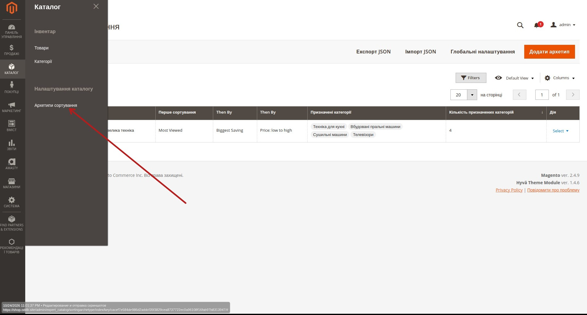
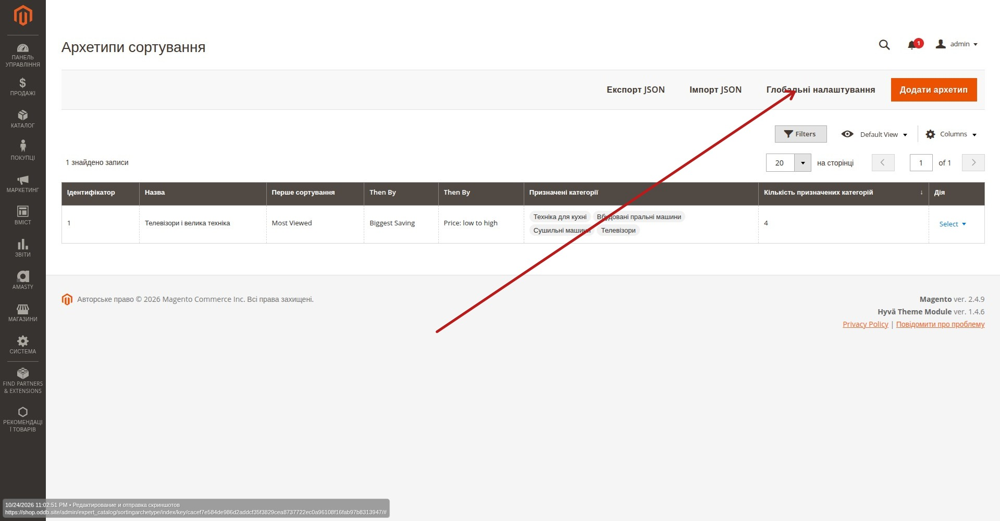
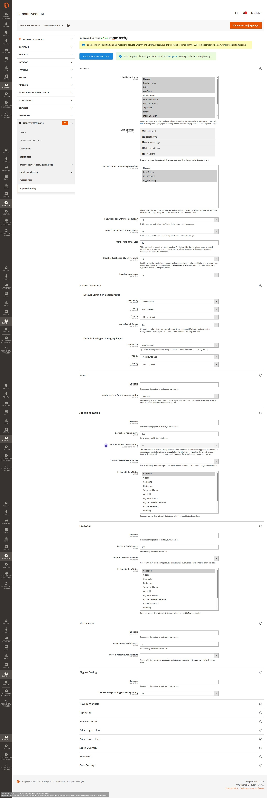
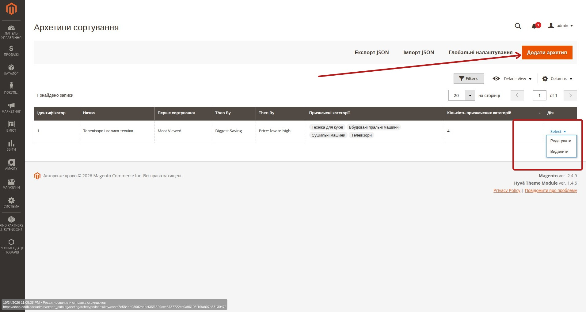
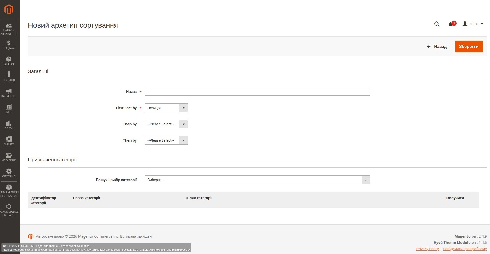
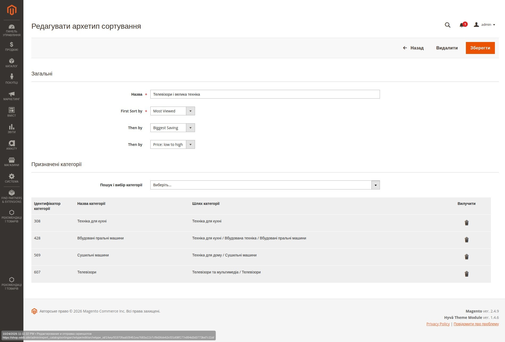

# Сортування товарів у Magento — інструкція адміністратора

> **Модулі:** Magento 2.4.9, Amasty Improved Sorting, Expert_Catalog.
> **Призначення:** налаштування сортування товарів у категоріях, окремих правил пошуку та перенесення архетипів між середовищами.
> **Мова інтерфейсу:** українська; окремі назви полів Amasty залишаються англійською.

## 1. Як працює сортування

У системі є два рівні налаштувань для **сторінок категорій (PLP)**:

| Рівень | Де налаштовується | Коли діє |
| --- | --- | --- |
| Глобальна послідовність Amasty | **Глобальні налаштування** → Amasty Improved Sorting | Категорія **не має** призначеного архетипу |
| Архетип сортування Expert_Catalog | **Каталог → Налаштування каталогу → Архетипи сортування** | Категорія має призначений архетип |

**Архетип має пріоритет над глобальною послідовністю для категорій.** Він задає до трьох послідовних критеріїв: **First Sort by → Then by → Then by**. Наступний критерій використовується для товарів з однаковим значенням попереднього.

Архетип діє на основний список товарів сторінки категорії. Він **не** керує результатами пошуку, autocomplete, рекомендаціями, CMS-блоками або сторінкою товару (PDP). Якщо покупець явно вибирає спосіб сортування в toolbar, цей вибір має пріоритет; другий і третій критерії архетипу до ручного вибору не додаються.

## 2. Де знайти налаштування

В адміністративній панелі відкрийте **Каталог → Налаштування каталогу → Архетипи сортування**. Розділ «Інвентар» залишається окремим.

На сторінці архетипів доступні: **Експорт JSON**, **Імпорт JSON**, **Глобальні налаштування** і **Додати архетип**.

**Глобальні налаштування** відкривають конфігурацію **Amasty Improved Sorting** у поточній адміністративній панелі. Адреса формується Magento автоматично; її не потрібно копіювати між середовищами. Доступ до кнопки залежить від дозволу `Amasty_Sorting::config`.

## 3. Глобальні налаштування Amasty Improved Sorting

У конфігурації Amasty визначаються доступні методи, їхній порядок у toolbar, напрямки сортування та стандартні послідовності для категорій і пошуку.

### 3.1. Загальні параметри

| Параметр | Що означає |
| --- | --- |
| **Disable Sorting By** | Приховує метод із ручного вибору покупця. Приховування не тотожне забороні його використання в архетипі. Expert_Catalog враховує призначені архетипи для індексації потрібних методів. |
| **Sorting Order** | Порядок доступних покупцеві способів у toolbar. Це **не** послідовність First/Then/Then. |
| **Sort Attributes Descending by Default** | Методи, для яких за замовчуванням застосовується напрямок `DESC`. |
| **Default Sorting on Category Pages** | Запасна послідовність для категорій без архетипу. |
| **Default Sorting on Search Pages** | Окрема послідовність для сторінок результатів пошуку. |
| **Use in Search Popup** | Визначає, чи використовує Search Popup налаштоване сортування пошуку; поведінку popup потрібно перевіряти окремо. |

### 3.2. Послідовність для категорій

У **Default Sorting on Category Pages**:

1. **First Sort by** — основний критерій.
2. **Then by** — додатковий критерій.
3. Другий **Then by** — третій критерій.

Не задавайте третій критерій без другого. Для категорії з архетипом глобальна послідовність замінюється його послідовністю.

### 3.3. Значення методів

| Метод | Призначення |
| --- | --- |
| **Most Viewed** | Популярність за переглядами; залежить від статистики та налаштованого періоду. |
| **Best Sellers** | Популярність за продажами; потрібна накопичена статистика замовлень. |
| **Biggest Saving** | Найбільша економія за логікою Amasty. **Не слід вважати її відсотковою знижкою без перевірки налаштувань.** |
| **Price: low to high / Price ASC** | Ціна за зростанням. |
| **Price: high to low / Price DESC** | Ціна за спаданням. |
| **Position** | Позиція товару всередині категорії Magento. |
| **Newest / Новий** | Метод Amasty, прив'язаний у проєкті до керованого атрибута новинки; не прирівнювати автоматично до дати створення. |
| **Top Rated / Rating** | Сортування за рейтингом; для Stage 0 не рекомендоване. |

Напрямок `ASC/DESC` не задається окремо в архетипі: використовується налаштування відповідного методу Amasty.

## 4. Список архетипів

Таблиця показує назву архетипу, три критерії, призначені категорії, кількість категорій та останню колонку **«Дія»**.

У колонці **Дія → Select** доступні **Редагувати** і **Видалити**. Якщо порядок колонок відрізняється, перевірте персональне представлення Grid (**Default View / Columns**): Magento може зберігати його у UI Bookmarks.

**Важливо:** зміна спільного архетипу впливає одразу на **всі** призначені категорії.

## 5. Створення нового архетипу

1. На сторінці списку натисніть **Додати архетип**.
2. У полі **Назва** вкажіть зрозумілу назву для адміністраторів.
3. У **First Sort by** виберіть обов'язковий перший критерій.
4. За потреби задайте другий і третій **Then by**.
5. У блоці **Призначені категорії** знайдіть і виберіть потрібні категорії.
6. Перевірте список призначень і натисніть **Зберегти**.

Один архетип може бути призначений багатьом категоріям, але **одна категорія може належати лише одному архетипу**. Призначення батьківської категорії **не поширюється автоматично** на дочірні. Повторювати один метод у межах однієї послідовності не потрібно.

## 6. Редагування архетипу та категорій

Відкрийте **Дія → Редагувати**. Можна змінити назву, послідовність критеріїв і список категорій. Для додавання категорії використовуйте поле пошуку; для вилучення — іконку кошика в її рядку. Після перевірки натисніть **Зберегти**.

У прикладі на скриншоті архетип **«Телевізори і велика техніка»** має послідовність **Most Viewed → Biggest Saving → Price: low to high** та призначений категоріям **308, 428, 569, 607**. Це **приклад фактичної конфігурації на момент знімка**, а не універсальна рекомендація для всіх категорій.

Якщо категорія вже належить іншому архетипу, система не перепризначає її автоматично. Спочатку потрібно свідомо вилучити призначення з попереднього архетипу.

## 7. Імпорт та експорт JSON

**Експорт JSON** і **Імпорт JSON** переносять архетипи разом із призначеннями категорій. **Глобальна конфігурація Amasty у JSON не входить.**

### 7.1. Експорт

Відкрийте список архетипів і натисніть **Експорт JSON**. Збережіть `sorting-archetypes.json` у контрольованому місці.

Формат: `schema = expert_catalog.sorting_archetypes`, `version = 1.0`. Для кожного архетипу зберігаються UUID, назва, коди методів та ідентичності категорій (`entity_id`, `entity_path`, `url_key_path`, `name_path`). Локальний числовий ID архетипу не використовується як переносимий ключ.

### 7.2. Імпорт

1. Натисніть **Імпорт JSON**.
2. Виберіть файл `.json` розміром до **1 МБ**.
3. Натисніть **Попередній перегляд імпорту**.
4. Перевірте створення, оновлення, незмінні записи, нові призначення, пропуски та конфлікти.
5. Лише після перевірки натисніть **Застосувати імпорт**.

| Статус preview | Значення |
| --- | --- |
| **Create** | Архетип із таким UUID відсутній — буде створений. |
| **Update** | UUID існує, але назва або критерії відрізняються. Preview показує попередню й нову послідовності та кількість поточних призначень, на які вплине зміна. |
| **Unchanged** | UUID, назва і критерії збігаються. |

Для категорій спочатку перевіряється `entity_id` разом із повним `url_key_path`; якщо ID відрізняється, шукається точний збіг повного `url_key_path`. Одного збігу назви недостатньо.

**Попередження:** відсутня або неоднозначна категорія пропускається. **Блокуючий конфлікт:** категорія вже належить іншому архетипу, різні архетипи у файлі претендують на одну категорію або ім'я належить іншому UUID. За блокуючих конфліктів Apply недоступний.

Імпорт **не видаляє** архетипи або призначення, яких немає у файлі, і **не перепризначає** конфліктні категорії. Повторне завантаження того самого JSON не має створювати дублікати.

> **Місце для майбутніх скриншотів:** екран завантаження JSON, preview, приклад попередження та блокуючого конфлікту. Цих зображень у поточному наборі немає.

## 8. Сортування результатів пошуку

Пошук налаштовується **окремо** в **Amasty Improved Sorting → Default Sorting on Search Pages**. Категорійні архетипи не застосовуються до search results, advanced search або autocomplete.

| Стадія | Рекомендація для звичайної сторінки пошуку |
| --- | --- |
| **Stage 0** | **Text Relevance → Most Viewed** |
| **Stage 2** | **Text Relevance → Best Sellers** |

**Text Relevance** залишається першим: спочатку потрібно знайти товари, що відповідають запиту, а вже потім ранжувати їх за популярністю чи продажами. Search Popup та autocomplete потребують окремої перевірки: наведена послідовність сама по собі не підтверджує їхню фактичну поведінку.

> **Місце для майбутнього скриншота:** блок **Default Sorting on Search Pages** крупним планом.

## 9. Холодний старт: Stage 0 → Stage 1 → Stage 2

Це **рекомендовані етапи ручного налаштування**, а не автоматичні режими Magento.

### Stage 0 — початковий період

Основний орієнтир: **Most Viewed → Newest** там, де це погоджено. **Most Viewed** замінює **Best Sellers** як головний сигнал за недостатньої статистики продажів. **Rating** на цій стадії не використовують. Для ігрових товарів, де це передбачено PRD, першим залишається **Newest**.

Перед використанням Most Viewed перевіряйте збір переглядів та індексацію Amasty. Перші 14 днів команда може вручну підтримувати вітрини; це не означає автоматичної зміни PLP-сортування.

### Stage 1 — накопичення статистики

Після оцінки якості замовлень команда може поступово впроваджувати **Best Sellers**. **Rating** поки не використовують.

### Stage 2 — цільові правила PRD

Наведені нижче правила — **цільова модель PRD**, а не підтвердження поточної конфігурації сайту.

| Архетип | Цільова послідовність |
| --- | --- |
| Смартфони | Best Sellers → Rating → Most Viewed |
| Телевізори і велика техніка | Best Sellers → Biggest Saving → Rating |
| Ноутбуки і ПК | Best Sellers → Newest → Rating |
| Аксесуари | Most Viewed → Price ASC → Best Sellers |
| Ігрові товари | Newest → Best Sellers → Rating |
| Дрібна техніка і товари для дому | Best Sellers → Rating → Price ASC |
| Кліматична техніка | Position → Best Sellers → Biggest Saving |
| Без окремого архетипу | Best Sellers → Most Viewed → Price ASC |

Для переходу між етапами потрібно погодити правила, перевірити статистику та індекси, змінити архетипи або глобальну конфігурацію, перевірити storefront і зафіксувати причину зміни. Орієнтири 0–30, 30–90 і 90+ днів **не є автоматичним таймером**.

## 10. Перевірка після налаштування

- Відкрийте категорію з призначеним архетипом **без** параметра ручного сортування.
- Перевірте вибраний метод у toolbar та фактичний порядок товарів.
- Перевірте ту саму категорію після AJAX-фільтрації / скидання фільтрів: SSR та AJAX мають узгоджуватися.
- Відкрийте категорію **без** архетипу: вона має використовувати глобальну послідовність.
- Вручну виберіть інший метод у toolbar та перевірте, що вибір покупця працює.
- Окремо перевірте пошук, Search Popup та autocomplete, якщо їхні налаштування змінювалися.
- Після перенесення JSON перевірте всі зіставлення категорій і попередження preview.

**Примітка:** індексацію, кеш і deployment виконуйте за затвердженою процедурою команди. Імпорт JSON сам по собі не переносить конфігурацію Amasty та не замінює розгортання.

---

## 11. Що ще потрібно доповнити

1. Скриншоти **Імпорт JSON → Preview → Apply** та приклад конфлікту.
2. Крупний скриншот **Default Sorting on Search Pages**.
3. Узгоджені бізнес-правила для переходу Stage 0/1/2.
4. Перевірений опис формули **Biggest Saving** саме для встановленої версії Amasty, якщо потрібна точна бізнес-інтерпретація.
5. Перевірка актуальних значень глобальної конфігурації та налаштувань пошуку на цільовому середовищі.