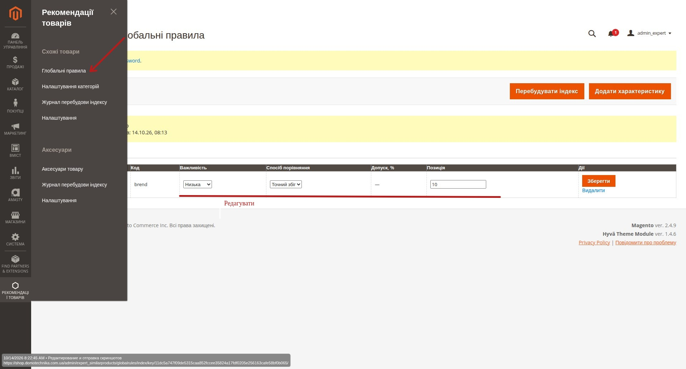
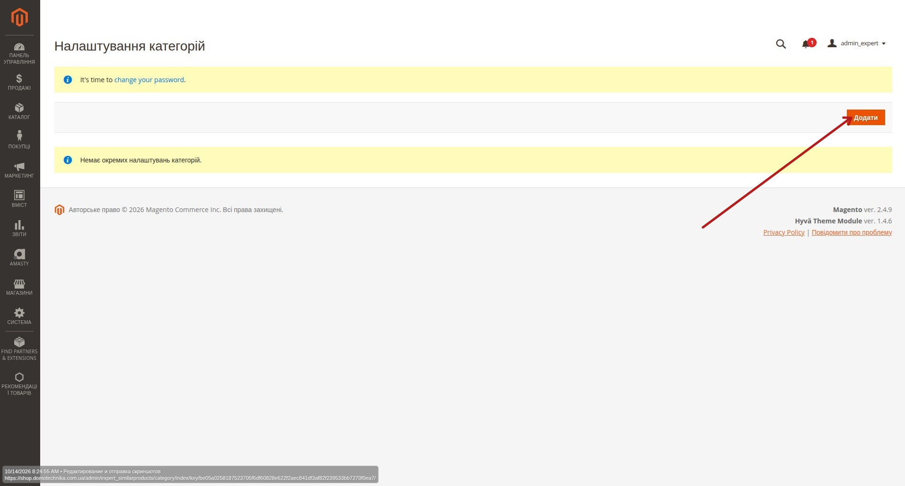
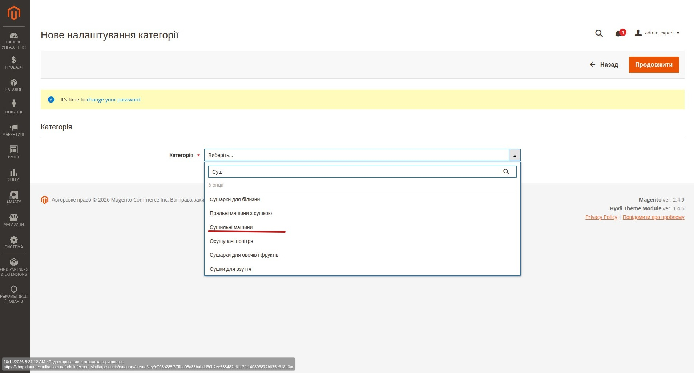
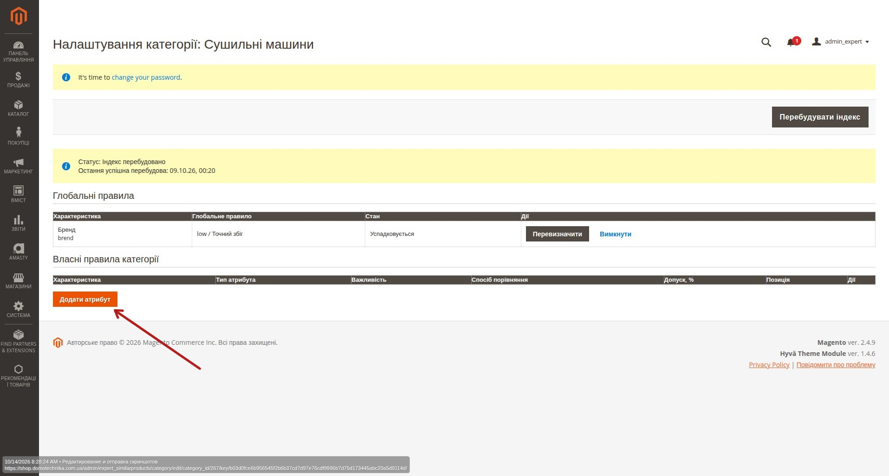
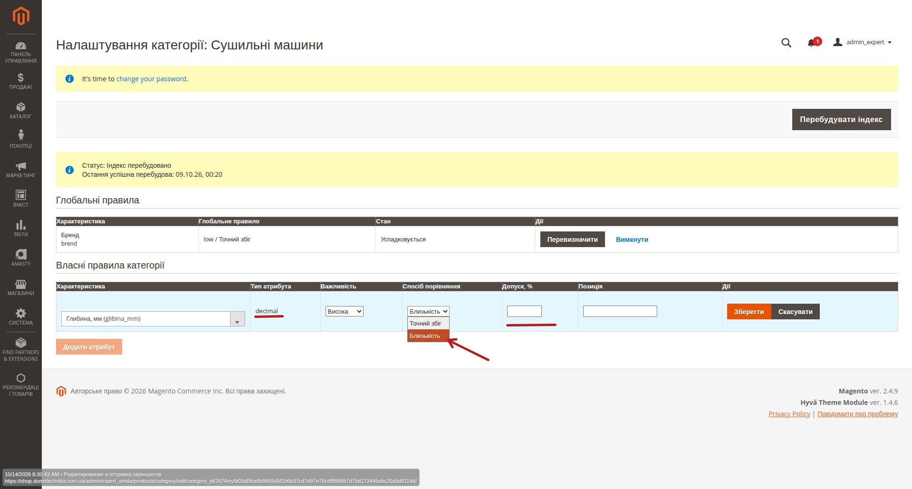
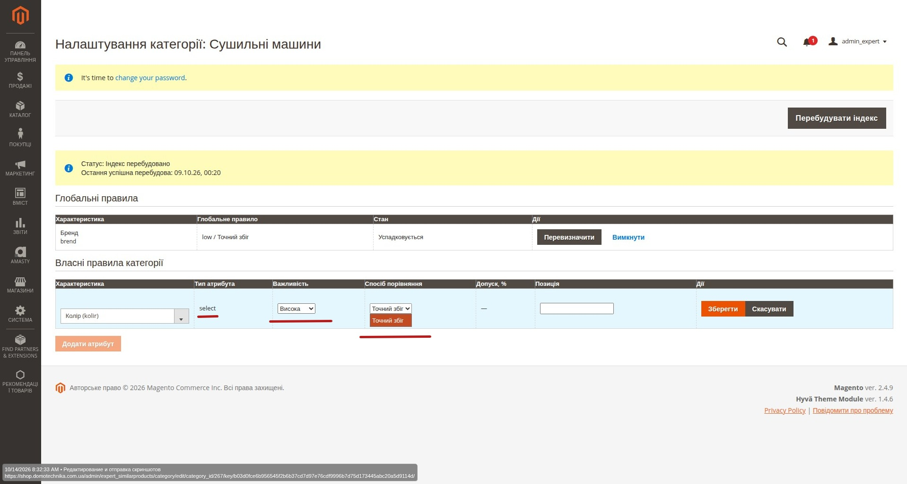
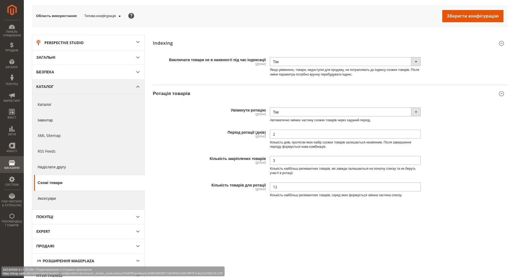
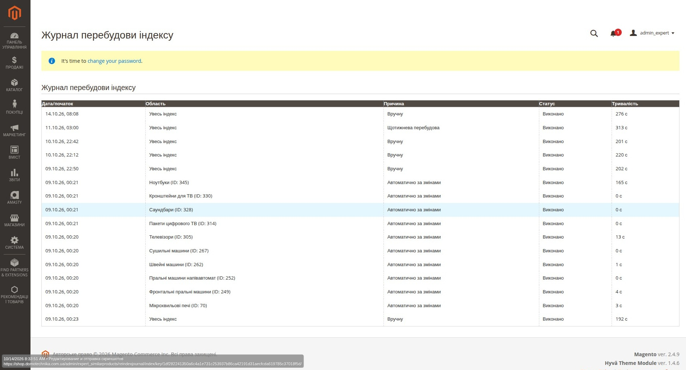

# Схожі товари в Magento: інструкція для менеджера

## 1. Для чого потрібен модуль «Схожі товари»

Модуль **Expert_SimilarProducts** автоматично підбирає схожі товари для картки товару на основі характеристик товарів у тій самій категорії.

Менеджеру не потрібно вручну прив'язувати кожен схожий товар. Замість цього налаштовуються правила:

- **які характеристики порівнювати**;
- **наскільки важлива кожна характеристика**;
- **яким способом порівнювати значення**;
- **чи потрібен допустимий відсоток відхилення**;
- **у якому порядку зберігати правила**.

Загальна логіка:

```text
Товар
↓
його категорія
↓
інші товари цієї ж категорії
↓
правила схожості
↓
розрахунок score
↓
TOP 30 у persistent index
↓
runtime-відбір
↓
до 8 товарів на PDP
```

> Важливо: модуль не використовує стандартні Magento Related Products, Up-sell або Cross-sell. Схожість розраховується окремим механізмом.

---

## 2. Основні поняття

### Вихідний товар

Товар, для якого потрібно показати блок **«Схожі товари»**.

Наприклад:

```text
Сушильна машина Samsung DV90...
```

### Кандидат

Інший товар із тієї самої категорії, який система може порівняти з вихідним товаром.

### Правило

Налаштування, яке говорить системі:

> яку характеристику порівнювати, яким способом і наскільки сильно вона повинна впливати на підсумкову схожість.

Приклад:

```text
Бренд
Важливість: Звичайна
Спосіб порівняння: Точний збіг
```

### Score

Підсумкова оцінка схожості кандидата від `0` до `100`.

Чим більший score, тим вище товар буде у базовому списку схожих товарів.

---

## 3. Де знаходиться керування

Основні розділи модуля знаходяться в Magento Admin у меню:

```text
Рекомендації товарів
→ Схожі товари
```

У модулі використовуються такі розділи:

- **Глобальні правила**
- **Налаштування категорій**
- **Журнал перебудови індексу**
- **Налаштування**

---

# 4. Як працюють глобальні правила

Відкрити сторінку можна через меню:

`Рекомендації товарів → Схожі товари → Глобальні правила`



## 4.1. Що таке глобальне правило

Глобальне правило — це правило, яке за замовчуванням застосовується до всіх категорій.

Наприклад, можна створити глобальне правило:

```text
Бренд
Важливість: Звичайна
Спосіб порівняння: Точний збіг
Позиція: 10
```

Після цього бренд буде брати участь у розрахунку схожості в кожній категорії, якщо конкретна категорія не перевизначила або не вимкнула це правило.

---

## 4.2. Глобальне правило не є жорстким фільтром

Приклад:

```text
Вихідний товар:
Бренд = Samsung
```

Кандидати:

```text
A — Samsung
B — LG
```

Якщо правило бренду має `Точний збіг`, товар `B` не видаляється автоматично.

Він просто отримає:

```text
0 балів за критерій «Бренд»
```

а товар `A` отримає максимальний бал за цей критерій.

Тому **правила схожості — це система рейтингу, а не система жорсткого виключення товарів за характеристиками**.

---

# 5. Налаштування конкретної категорії

Список налаштувань категорій відкривається через:

`Рекомендації товарів → Схожі товари → Налаштування категорій`



У розділі **«Налаштування категорій»** менеджер обирає категорію та бачить:

- глобальні правила;
- їхній стан у цій категорії;
- власні правила категорії;
- доступні дії;
- перебудову індексу категорії.

Наприклад:

```text
Категорія:
Сушильні машини
```

Якщо категорію ще не налаштовано, натисніть **«Додати»**, після чого оберіть її через пошуковий Magento UI-select.



Після вибору категорії відкриється сторінка її правил.



---

## 5.1. Успадкування глобального правила

Для глобального правила категорія може мати три стани.

### Успадкувати

Категорія використовує глобальне правило без змін.

```text
Глобальне правило:
Бренд / Звичайна / Точний збіг

Категорія:
Сушильні машини

Стан:
Успадковується
```

Ніякого окремого правила категорії для цього атрибута не потрібно.

---

## 5.2. Перевизначити

Якщо в конкретній категорії характеристика повинна мати іншу вагу або спосіб порівняння, глобальне правило можна перевизначити.

Наприклад:

```text
Глобально:
Бренд
Звичайна
Точний збіг
```

Для категорії:

```text
Телевізори:
Бренд
Висока
Точний збіг
```

Глобальне правило не змінюється. Зміна діє тільки для цієї категорії.

---

## 5.3. Вимкнути

Якщо глобальний атрибут у конкретній категорії не має сенсу, його можна вимкнути.

Наприклад:

```text
Глобальне правило:
Бренд
```

але для певної категорії бренд не повинен впливати на схожість.

Тоді:

```text
Стан → Вимкнути
```

У цій категорії правило бренду більше не бере участі в score.

---

# 6. Власні правила категорії

Категорія може мати власні характеристики, яких немає серед глобальних правил.

Наприклад, для категорії **«Сушильні машини»** можна додати:

```text
Тип завантаження
Максимальне завантаження, кг
Таймер відстрочки запуску
```

Такі правила працюють тільки в цій категорії.

---

## 6.1. Як додати власне правило

У секції:

```text
Власні правила категорії
```

натисніть:

```text
Додати атрибут
```

Після цього з'являється новий рядок, у якому потрібно вибрати:

- характеристику;
- важливість;
- спосіб порівняння;
- допуск, якщо він потрібен;
- позицію.

Після заповнення натисніть:

```text
Зберегти
```

Для числового атрибута система може запропонувати **«Точний збіг»** або **«Близькість»**. При виборі **«Близькість»** потрібно вказати **«Допуск, %»**.



Для `select`-атрибута доступний **«Точний збіг»**, а поле допуску не використовується.



---

# 7. Чому список атрибутів залежить від категорії

Для вибору характеристик система аналізує **Attribute Set** товарів поточної категорії.

Логіка:

```text
Категорія
↓
товари категорії
↓
Attribute Sets цих товарів
↓
підтримувані характеристики
↓
список доступних атрибутів
```

Це потрібно, щоб менеджеру не показували сотні характеристик, які не мають відношення до цієї категорії.

## Важливо

Attribute Set:

- не додає балів;
- не є правилом;
- не впливає на score;
- не обмежує кандидатів під час розрахунку.

Він використовується тільки для формування зручного списку характеристик у налаштуваннях.

---

# 8. Які атрибути можна використовувати

Система дозволяє тільки підтримувані типи характеристик.

Основні варіанти:

| Тип характеристики | Доступний спосіб порівняння |
|---|---|
| `select` | Точний збіг |
| `boolean` | Точний збіг |
| `multiselect` | Перетин значень |
| числовий `int` / `decimal` | Точний збіг, Близькість |
| нормалізований текст | Точний збіг |

Не всі системні Magento-поля доступні для правил.

Наприклад, службові поля, медіа, опис, короткий опис та інші непридатні характеристики не повинні використовуватися для розрахунку схожості.

---

# 9. Важливість характеристики

Для кожного правила менеджер обирає одну з трьох важливостей.

| В Admin | Внутрішня вага | Для чого |
|---|---:|---|
| **Висока** | 3 | один із головних критеріїв |
| **Звичайна** | 2 | стандартний критерій |
| **Низька** | 1 | додатковий критерій |

Менеджеру не потрібно вводити числову вагу вручну.

---

## 9.1. Приклад важливості

Для сушильної машини можна налаштувати:

```text
Тип завантаження     — Висока
Максимальне завантаження — Висока
Бренд                — Звичайна
Колір                — Низька
```

Це означає:

> тип і місткість повинні впливати на порядок сильніше, ніж бренд, а колір є лише додатковим сигналом.

---

## 9.2. Важливість не виключає товар

Навіть якщо правило має:

```text
Бренд → Висока
```

товар іншого бренду може залишитися серед кандидатів.

Він просто втратить бал за бренд.

---

# 10. Способи порівняння

У модулі використовуються три основні способи порівняння.

---

## 10.1. Точний збіг

У Magento Admin:

```text
Точний збіг
```

Внутрішнє значення:

```text
exact
```

Питання:

> Значення однакові?

Приклади:

```text
Samsung ↔ Samsung → збіг
Samsung ↔ LG      → немає збігу
```

```text
Фронтальне ↔ Фронтальне → збіг
Фронтальне ↔ Вертикальне → немає збігу
```

Для чисел:

```text
8 ↔ 8   → збіг
8 ↔ 9   → немає збігу
```

### Коли використовувати

- бренд;
- тип товару;
- технологія;
- роздільна здатність;
- булеві характеристики;
- інші значення, де потрібна саме ідентичність.

---

# 11. Близькість

У Magento Admin:

```text
Близькість
```

Внутрішнє значення:

```text
proximity
```

Використовується для числових характеристик.

Питання:

> Наскільки близьке числове значення кандидата до вихідного товару?

Приклади:

- максимальне завантаження, кг;
- діагональ;
- потужність;
- об'єм;
- ємність;
- вага;
- частота.

---

## 11.1. Допуск, %

Для `Близькість` потрібно вказати:

```text
Допуск, %
```

Наприклад:

```text
Вихідний товар:
Максимальне завантаження = 8 кг

Допуск:
20%
```

Тоді:

- `8 кг` — максимальна схожість;
- `7 кг` або `9 кг` — часткова схожість;
- значення, що занадто сильно відрізняються, отримують `0` за цей критерій.

Чим ближче значення — тим більший бал.

---

## 11.2. Важливо про допуск

Допуск використовується тільки для:

```text
Близькість
```

Для:

```text
Точний збіг
Перетин значень
```

поле допуску не використовується.

---

# 12. Перетин значень

У Magento Admin:

```text
Перетин значень
```

Внутрішнє значення:

```text
intersection
```

Використовується для `multiselect`.

Приклад:

```text
Вихідний товар:
A, B
```

Кандидати:

```text
A, B  → дуже схожий набір
A     → частковий збіг
A, C  → частковий збіг
C     → збігу немає
```

Чим більше спільних значень — тим більший бал за характеристику.

---

# 13. Як правильно вибрати спосіб порівняння

| Характеристика | Рекомендований спосіб |
|---|---|
| Бренд | Точний збіг |
| Тип завантаження | Точний збіг |
| Роздільна здатність | Точний збіг |
| Максимальне завантаження, кг | Близькість |
| Діагональ | Близькість |
| Потужність | Близькість |
| Набір функцій | Перетин значень |

Фактично доступні варіанти система визначає автоматично залежно від типу атрибута.

---

# 14. Що означає «Позиція»

Поле:

```text
Позиція
```

визначає стабільний порядок правил.

Наприклад:

```text
Бренд                   10
Тип завантаження        20
Максимальне завантаження 30
```

## Важливо

`Позиція` **не є вагою**.

Неправильно:

```text
Позиція 100
→ правило дуже важливе
```

Правильно:

```text
Важливість
→ визначає вплив на score

Позиція
→ визначає стабільний порядок правила
```

---

# 15. Як розраховується схожість

Кожен критерій дає результат від:

```text
0 до 1
```

Потім він множиться на вагу важливості.

Підсумковий score нормалізується до:

```text
0..100
```

Менеджеру не потрібно рахувати score вручну, але важливо розуміти принцип:

```text
сильніший збіг
+
більш важлива характеристика
=
вище кандидат у списку
```

---

# 16. Детальний приклад: сушильні машини

Припустимо, вихідний товар має:

```text
Бренд: Samsung
Тип завантаження: Фронтальне
Максимальне завантаження: 8 кг
Колір: Білий
```

Налаштуємо правила:

| Характеристика | Важливість | Спосіб |
|---|---|---|
| Тип завантаження | Висока | Точний збіг |
| Максимальне завантаження | Висока | Близькість, 20% |
| Бренд | Звичайна | Точний збіг |
| Колір | Низька | Точний збіг |

---

## Кандидат A

```text
Samsung
Фронтальне
8 кг
Чорний
```

Результат:

- тип завантаження — повний збіг;
- завантаження — повний збіг;
- бренд — повний збіг;
- колір — не збігся.

Кандидат отримає дуже високий score.

---

## Кандидат B

```text
LG
Фронтальне
9 кг
Білий
```

Результат:

- тип — збіг;
- 9 кг близько до 8 кг — частковий бал;
- бренд — не збігся;
- колір — збіг.

Товар залишається кандидатом, але його score буде нижчим.

---

## Кандидат C

```text
Samsung
Вертикальне
12 кг
Білий
```

Результат:

- бренд — збіг;
- тип — не збігся;
- 12 кг може бути за межами допуску;
- колір — збіг.

Наявність правильного бренду не гарантує високу позицію, якщо більш важливі характеристики відрізняються.

---

# 17. Відсутні значення

Якщо у вихідного товару немає значення певної характеристики, система не повинна штрафувати кандидатів за цю характеристику.

Наприклад:

```text
Вихідний товар:
Діагональ = немає значення
```

Правило `Діагональ` не бере участі в score цього товару.

Якщо ж вихідний товар має значення, а кандидат його не має:

```text
Вихідний товар: 55
Кандидат: немає значення
```

кандидат отримує `0` за цей критерій.

---

# 18. Звідки беруться кандидати

Кандидати беруться з тієї самої категорії, що й вихідний товар.

Базова логіка:

```text
Вихідний товар
↓
його категорія
↓
інші enabled/catalog-visible товари цієї категорії
```

Сам вихідний товар зі списку кандидатів виключається.

---

## 18.1. Важливе правило категорії

Поточна модель Similar Products очікує, що товар має рівно одну категорію в контексті цього алгоритму.

| Категорії товару | Результат |
|---|---|
| 0 | схожі товари не розраховуються |
| 1 | нормальна робота |
| більше 1 | система не обирає категорію автоматично |

Якщо для товару не формується Similar Products, одна з перших перевірок — його category membership.

---

# 19. Індекс схожих товарів

Розрахунок не виконується заново при кожному відкритті PDP.

Система заздалегідь будує persistent index:

```text
expert_similar_product_index
```

Для кожного вихідного товару зберігається:

```text
TOP 30
```

кандидатів у базовому порядку схожості.

Це дозволяє storefront швидко отримувати вже готовий список.

---

# 20. Глобальні налаштування Similar Products

Загальні параметри модуля відкриваються через:

`Рекомендації товарів → Схожі товари → Налаштування`

На сторінці доступні блоки **Indexing** та **Ротація товарів**.



## 20.1. Виключення товарів без наявності під час індексації

У блоці:

```text
Indexing
```

є параметр:

```text
Виключати товари не в наявності під час індексації
```

---

## Ні

Це базовий режим.

```text
Наявність не впливає на persistent Similar index.
```

Товар без наявності може залишатися серед TOP 30.

---

## Так

Magento MSI перевіряє кандидатів до розрахунку фінального TOP 30.

```text
candidate pool
↓
MSI salability
↓
видалити unsalable
↓
score/ranking
↓
TOP 30
↓
index
```

Це важливо: товар без наявності виключається **до** TOP 30, тому його місце може зайняти наступний доступний кандидат.

---

## 20.2. Після зміни налаштування потрібна перебудова

Перемикання:

```text
Ні → Так
```

або:

```text
Так → Ні
```

не перебудовує існуючий index автоматично.

Після зміни потрібно виконати:

```text
ручний full rebuild Similar Products
```

---

## 20.3. Зміна залишків не запускає Similar rebuild

Звичайна зміна:

- qty;
- MSI stock;
- salability;

сама по собі не створює dirty marker Similar Products.

Отже, при index-time виключенні OOS актуальний стан наявності застосовується під час наступної manual або scheduled перебудови.

---

# 22. Перебудова індексу

Є декілька варіантів rebuild.

### Перебудова конкретної категорії

Використовується, коли потрібно одразу оновити одну категорію.

Наприклад:

```text
Налаштування категорії: Сушильні машини
→ Перебудувати індекс
```

### Глобальна перебудова

Перераховує всі налаштовані категорії.

Її потрібно використовувати, наприклад:

- після зміни глобальних правил;
- після зміни глобального index-time налаштування;
- для повного reconciliation.

---

# 23. Автоматична перебудова після змін

Для релевантних змін товарів категорія позначається як dirty.

Загальна схема:

```text
зміна товару
↓
category dirty
↓
15 хвилин без нових релевантних змін
↓
cron
↓
автоматична перебудова категорії
```

Quiet period потрібен, щоб під час великої синхронізації не запускати rebuild після кожного окремого товару.

Cron перевіряє чергу приблизно кожні 5 хвилин.

---

## 22.1. Що може викликати automatic rebuild

До релевантних змін належать, зокрема:

- зміна характеристики, яка використовується Similar rule;
- зміна `status`;
- зміна `visibility`;
- зміна category membership;
- видалення товару;
- зміна правила категорії.

---

## 22.2. Що не повинно запускати automatic Similar rebuild

Наприклад:

- stock / MSI qty;
- salability;
- rotation;
- нерелевантні характеристики;
- звичайні price-поля, які не є Similar rules.

---

# 24. Глобальні правила та rebuild

Після зміни глобального правила конфігурація зберігається, але система не повинна автоматично перебудовувати всі категорії одна за одною через dirty markers.

Тому після важливої зміни глобальних правил рекомендується виконати:

```text
глобальну перебудову індексу
```

---

# 25. Журнал перебудови індексу

Розділ:

```text
Журнал перебудови індексу
```

дозволяє перевірити, коли і чому виконувалася перебудова.



У журналі можна побачити:

- дату/час;
- область;
- причину;
- статус;
- тривалість.

Приклади причин:

```text
Вручну
Автоматично за змінами
Щотижнева перебудова
```

---

## 24.1. Як користуватися журналом

Якщо менеджер змінив правило або була велика синхронізація і результат на PDP не оновився, перевірте:

1. чи була потрібна category позначена для rebuild;
2. чи з'явився automatic/manual job;
3. чи має job статус `Виконано`;
4. коли він завершився.

---

# 26. Щотижнева reconciliation-перебудова

Окремо існує safety rebuild:

```text
щонеділі о 03:00
```

за timezone Magento.

Він потрібен як додаткове узгодження persistent index із поточним станом каталогу.

---

# 27. Як працює PDP

На сторінці товару similarity заново не розраховується.

PDP читає готовий persistent index.

У базовому runtime flow:

```text
TOP 30 index
↓
завантаження товарів
↓
runtime selection
↓
до 8 карток
```

Максимальна кількість товарів у блоці:

```text
8
```

---

# 28. Ротація схожих товарів

У розділі:

```text
Схожі товари
→ Налаштування
→ Ротація товарів
```

можна керувати зміною частини списку рекомендацій.

Основна мета:

> не показувати користувачеві постійно одну й ту саму вісімку, але при цьому не втрачати найрелевантніші товари.

---

## 27.1. Увімкнути ротацію

```text
Так
```

— частина списку може змінюватися відповідно до періоду.

```text
Ні
```

— використовується стабільний базовий порядок.

---

## 27.2. Період ротації, днів

Наприклад:

```text
2
```

означає:

> одна й та сама детермінована комбінація використовується протягом двох календарних днів, після чого формується інша.

Це не cron-інтервал.

---

## 27.3. Кількість закріплених товарів

Наприклад:

```text
3
```

Перші три найбільш релевантні товари залишаються на початку списку й не беруть участі в ротації.

Таким чином найкращі рекомендації не губляться.

---

## 27.4. Кількість товарів для ротації

Наприклад:

```text
12
```

означає:

> система використовує пул із найбільш релевантних кандидатів, серед яких формується змінна частина списку.

Постійний index при цьому все одно зберігає до 30 кандидатів.

---

# 29. Наявність і ротація

У runtime salability має вищий пріоритет за rotation.

При вимкненому index-time OOS filtering базовий принцип такий:

```text
доступні товари
↓
недоступні товари
↓
LIMIT 8
```

Rotation застосовується всередині відповідних груп і не перераховує score.

Якщо index-time параметр:

```text
Виключати товари не в наявності під час індексації = Так
```

увімкнений, unsalable товари взагалі не потрапляють у persistent Similar index під час rebuild.

---

# 30. Приклад повного налаштування категорії «Сушильні машини»

## Глобальне правило

```text
Бренд
Звичайна
Точний збіг
Позиція 10
```

## Власні правила категорії

```text
Тип завантаження
Висока
Точний збіг
Позиція 20
```

```text
Максимальне завантаження, кг
Висока
Близькість
Допуск 20%
Позиція 30
```

```text
Таймер відстрочки запуску
Низька
Точний збіг
Позиція 40
```

У такій конфігурації система перш за все намагатиметься підняти товари з близькими ключовими технічними характеристиками, а бренд і другорядні функції використовуватиме як додаткові сигнали.

---

# 31. Рекомендований порядок налаштування нової категорії

## Крок 1

Відкрийте:

```text
Рекомендації товарів
→ Схожі товари
→ Налаштування категорій
```

## Крок 2

Оберіть потрібну категорію.

## Крок 3

Перевірте глобальні правила.

Для кожного вирішіть:

```text
Успадкувати
Перевизначити
Вимкнути
```

## Крок 4

Додайте характеристики, специфічні для категорії.

## Крок 5

Для кожної характеристики визначте:

```text
Важливість
Спосіб порівняння
Допуск
Позицію
```

## Крок 6

Збережіть правила.

## Крок 7

Якщо результат потрібен одразу — натисніть:

```text
Перебудувати індекс
```

## Крок 8

Перевірте:

```text
Журнал перебудови індексу
```

## Крок 9

Відкрийте декілька PDP товарів категорії й оцініть результат.

---

# 32. Як вибирати правила: практичний підхід

При налаштуванні категорії менеджеру варто поставити собі питання:

### 1. Які характеристики роблять два товари справді схожими?

Це кандидати на:

```text
Висока
```

Наприклад:

- діагональ;
- завантаження;
- тип конструкції;
- потужність;
- об'єм.

### 2. Які характеристики важливі, але не критичні?

Це:

```text
Звичайна
```

Наприклад:

- бренд;
- серія;
- тип технології.

### 3. Які характеристики лише трохи покращують релевантність?

Це:

```text
Низька
```

Наприклад:

- колір;
- другорядні функції;
- декоративні параметри.

---

# 33. Типові помилки

## Помилка 1. Робити всі характеристики «Висока»

Тоді другорядні характеристики починають впливати так само сильно, як ключові.

Краще розділити:

```text
головне
→ Висока

важливе
→ Звичайна

додаткове
→ Низька
```

---

## Помилка 2. Використовувати «Точний збіг» для чисел, які можуть трохи відрізнятися

Наприклад:

```text
Максимальне завантаження
8 кг
9 кг
```

При `Точний збіг` це буде:

```text
немає збігу
```

Якщо 8 і 9 кг повинні вважатися близькими, краще:

```text
Близькість + Допуск
```

---

## Помилка 3. Вважати «Позицію» важливістю

Позиція не збільшує score.

Для цього є:

```text
Висока / Звичайна / Низька
```

---

## Помилка 4. Очікувати, що інший бренд буде виключений

Similar rules не є жорстким фільтром.

Інший бренд просто отримує менше балів.

---

## Помилка 5. Змінити глобальне правило й не перебудувати index

Після значущої зміни global rules слід виконати global rebuild.

---

## Помилка 6. Увімкнути OOS exclusion і не перебудувати index

Зміна параметра:

```text
Виключати товари не в наявності під час індексації
```

не змінює вже існуючі index rows сама по собі.

Потрібен manual full rebuild.

---

## Помилка 7. Очікувати автоматичну переіндексацію після зміни залишків

Stock/MSI зміни не ставлять category dirty.

Якщо використовується index-time exclusion, актуальний stock буде врахований при наступній перебудові.

---

# 34. Якщо схожі товари не з'явилися

Перевірте послідовно:

1. Чи належить товар правильній категорії.
2. Чи має категорія effective rules.
3. Чи заповнені потрібні характеристики у товарів.
4. Чи була категорія перебудована.
5. Чи є успішний запис у журналі.
6. Чи не виключені всі кандидати через налаштування наявності.
7. Чи є достатньо enabled/catalog-visible кандидатів.
8. Чи не має товар некоректне category membership.

---

# 35. Якщо результат виглядає нерелевантним

Перевірте:

- чи правильно вибрана `Важливість`;
- чи не використовується `Точний збіг` там, де потрібна `Близькість`;
- чи адекватний `Допуск, %`;
- чи не має другорядна характеристика занадто високу важливість;
- чи заповнені значення атрибутів у source та candidate products.

---

# 36. Практичний чекліст менеджера

Перед завершенням налаштування категорії перевірте:

- [ ] Категорія обрана правильно.
- [ ] Глобальні правила переглянуті.
- [ ] Непотрібні global rules вимкнені або перевизначені.
- [ ] Додані специфічні характеристики категорії.
- [ ] Для ключових критеріїв правильно вибрана важливість.
- [ ] Для числових параметрів перевірено, чи потрібна `Близькість`.
- [ ] `Допуск, %` має бізнес-сенс.
- [ ] `Позиція` використовується лише як порядок.
- [ ] Після глобальної зміни виконано global rebuild.
- [ ] Після зміни index-time OOS setting виконано full rebuild.
- [ ] Журнал показує успішну перебудову.
- [ ] Результат перевірено на декількох реальних PDP.

---

# 37. Коротка пам'ятка

## Глобальне правило

```text
Працює у всіх категоріях
↓
якщо категорія його не перевизначила або не вимкнула
```

## Власне правило категорії

```text
Працює тільки в конкретній категорії
```

## Висока / Звичайна / Низька

```text
визначає силу впливу характеристики на score
```

## Точний збіг

```text
значення мають бути однаковими
```

## Близькість

```text
для числових значень
+
потрібен Допуск, %
```

## Перетин значень

```text
для multiselect
```

## Позиція

```text
порядок правила
НЕ вага
```

## Persistent index

```text
TOP 30 кандидатів
```

## PDP

```text
до 8 товарів
```

## OOS exclusion

```text
Так
→ unsalable кандидати виключаються під час rebuild

після зміни
→ manual full rebuild
```

## Rotation

```text
не змінює score
не змінює index
змінює тільки runtime presentation
```

---

# 38. Головний принцип

Правильне налаштування Similar Products починається не з максимальної кількості правил, а з правильного вибору характеристик.

Менеджер повинен відповісти на три питання:

### 1. Що робить два товари справді схожими?

Це основні правила з високою важливістю.

### 2. Які відмінності допустимі?

Для числових характеристик це допомагає визначити `Близькість` та `Допуск, %`.

### 3. Які характеристики лише допомагають уточнити порядок?

Для них достатньо звичайної або низької важливості.

Хороше правило не намагається зробити всі товари однаковими. Воно допомагає системі правильно розташувати найбільш релевантні альтернативи для покупця.
